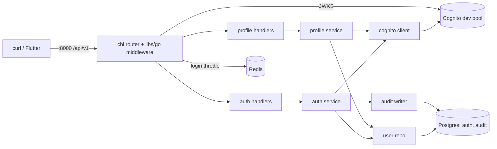

# Implementation Plan: Auth facade (sketch)

## Problem statement
Build the first backend service, the Go auth facade in `services/auth`, together with the parts of `libs/go` it needs. The goal is a working sketch: every `/auth/*` and `/me` endpoint in `openapi.yaml` runs locally against a real Cognito pool and local Postgres and Redis. This is not the finished, hardened auth layer.

## Requirements
- **Endpoints** (Interface Design §1.2): `POST /auth/register` (202), `confirm` (204), `resend-code` (204), `login` (200), `refresh` (200), `logout` (204, JWT), `GET /me` (200, JWT), `PATCH /me` (200, JWT). All paths start with `/api/v1`.
- **Cognito** (Interface Design §3.1): confidential app client using `SECRET_HASH`; `USER_PASSWORD_AUTH`, `REFRESH_TOKEN_AUTH`, `RevokeToken`, `GetUser`.
- **Behavior rules from the docs:**
  - Responses never reveal whether an email is registered: register and resend-code return the same response either way, and login failures return a generic 401.
  - An unconfirmed account gets a 403 with rule `account-not-confirmed`.
  - The profile is created on first login with `INSERT … ON CONFLICT DO NOTHING`.
  - Token responses carry `Cache-Control: no-store`.
- **Errors:** RFC 9457 Problem Details with `correlationId`. The `X-Correlation-Id` header is echoed on every response.
- **Data:** `auth.users (id = Cognito sub, display_name, created_at, updated_at)` and the view `auth.v_user_public`. Audit actions `auth.register`, `auth.login_succeeded`, `auth.login_failed`, and `auth.logout` go to `audit.audit_log`, which is append-only.
- **Security:**
  - The service validates JWTs itself using the Cognito JWKS, checking signature, expiry, `client_id`, and `token_use=access`.
  - Login is throttled with a Redis counter.
  - Logs never contain tokens, passwords, or full email addresses (SEC-12).
- **RDS Proxy compatibility:** pgx uses `QueryExecModeExec` and session `SET` is not allowed.
- **Stack** (Architecture §3): chi, pgx/pgxpool, go-redis, AWS SDK for Go v2, lestrrat-go/jwx, slog JSON, golang-migrate, `go test`.

**User decisions**
- Build `libs/go` now, limited to what auth needs.
- Local development uses a real Cognito user pool the user creates in the console. Its IDs and client secret come from a gitignored `.env` file.
- The scope is a sketch. Each layer works end to end, but hardening comes later.
- The plan is saved as `AUTH_FACADE_PLAN.md` in the repo root, so the user can delete it when done.

**Out of scope for this plan:**
- GitHub Actions CI and the OpenAPI contract check (MAINT-01)
- OpenTelemetry and X-Ray
- Loading secrets from Secrets Manager. A config interface is in place, but values come from environment variables.
- The `X-Origin-Verify` check is implemented but turned off locally.
- Per-user read and write rate limits, circuit breaker, and the ECS and Terraform wiring

## Background
- Repo state: only docs. `services/`, `libs/`, `migrations/`, and `deploy/local/` do not exist yet.
- `openapi.yaml` defines a local server at `http://127.0.0.1:8000/api/v1`, so the service listens on `:8000` locally.
- The C4 L3 auth diagram (`docs/diagrams/c4-level3-auth.puml`) suggests these packages: `internal/http`, `internal/auth`, `internal/profile`, `internal/cognito`, `internal/store`. Shared packages are `libs/go/{middleware,health,config}`.
- Relevant docs: `docs/design-description/architecture-and-components.md` (§3 stack and RDS Proxy rules, §4.2 auth detail, §4.5 layout), `docs/design-description/interface-design.md` (§1.1 conventions/errors, §1.2 endpoints, §3.1 Cognito), `docs/design-description/data-design.md` (§1.1 schemas, `auth.users`, audit actions), `docs/openapi.yaml` (request/response schemas and field limits), `docs/requirement-specification/functional-requirements.md` (FR-AUTH), `non-functional-requirements.md` (SEC-01, SEC-09, SEC-11, SEC-12, REL-11).
- **Console setup needed:**
  - A user pool that uses email as the sign-in name and requires email verification.
  - An app client with a client secret and `ALLOW_USER_PASSWORD_AUTH` plus `ALLOW_REFRESH_TOKEN_AUTH` enabled.
  - Token revocation turned on, and refresh token rotation turned off. The `/auth/refresh` endpoint assumes rotation is off.
  - An `operators` group.

## Proposed solution



**Layout**
```
go.work                         # workspace: libs/go + services/auth
libs/go/        (module .../libs/go)
  config/ problem/ middleware/ (correlation, logging, recover, origin, jwtauth, ratelimit) health/ db/
services/auth/  (module .../services/auth)
  cmd/auth/main.go
  internal/{http,auth,profile,cognito,store}
  Dockerfile  README.md  .env.example
migrations/auth/  migrations/audit/
deploy/local/docker-compose.yml
```

Services depend on interfaces such as `CognitoAPI`, `UserRepo`, and `AuditWriter`, so unit tests can use fakes. Repositories run against the Compose Postgres. Cognito behavior is checked by hand against the dev pool.

## Task breakdown

**Task 0: Save the plan**
- Objective: write this plan to `/AUTH_FACADE_PLAN.md` in the repo root.
- Demo: the file is in the repo root on `feat/auth-facade`.

**Task 1: Workspace skeleton and a health endpoint**
- Objective: the service compiles, starts, and answers health checks.
- Guidance:
  - Create `go.work` and the `libs/go` and `services/auth` modules. Use the module path `github.com/<org>/MyCilinder-Backend/...` (ask the user for the org).
  - `libs/go/config` loads typed config from environment variables and fails fast when required ones are missing.
  - `libs/go/health` provides `/healthz` and a `/readyz` that takes a list of named checks.
  - `cmd/auth/main.go` sets up a chi router with slog JSON logging and shuts down cleanly on SIGTERM.
  - Add a `.gitignore` covering `.env`, and a `.env.example`.
- Tests: config parsing (missing and invalid values) and the health handlers, using `httptest`.
- Demo: `go run ./services/auth/cmd/auth` starts the service, and `curl :8000/healthz` returns 200.

**Task 2: Shared middleware and Problem Details**
- Objective: every response has a correlation id, and every error uses the agreed format.
- Guidance:
  - `libs/go/problem` holds the type constants from Interface Design §1.1 and a `Write(w, r, status, type, detail, errors...)` helper that sets `application/problem+json`.
  - Middleware covers correlation id (read `X-Correlation-Id` or generate one, store it in the context and the logger, echo it back), request logging that skips bodies and the Authorization header, panic recovery that returns a 500 problem, and the origin-verify check (turned on by config).
  - Mount the routes under `/api/v1`. Add stub auth handlers that return 501 problems.
- Tests: the middleware unit tests and the problem JSON shape.
- Demo: `curl -i -X POST :8000/api/v1/auth/login` returns a 501 problem with `correlationId` in the body matching the header.

**Task 3: Local infrastructure and migrations**
- Objective: Postgres and Redis run locally with the `auth` and `audit` schemas.
- Guidance:
  - `deploy/local/docker-compose.yml` runs Postgres 16 and Redis 7, plus a `migrate/migrate` one-shot container.
  - `migrations/auth` creates the schema, the `users` table, and `v_user_public`. `migrations/audit` creates the schema and `audit_log`, with a comment about INSERT-only grants. Each migration has an up and a down file.
  - Create the `auth_svc` role with grants on its own schema plus `INSERT` on `audit.audit_log`. Set `search_path` and `statement_timeout` with `ALTER ROLE`.
  - `libs/go/db` builds a pgxpool with `QueryExecModeExec`, max 10 connections, and TLS controlled by config. It also exposes a ping check, and `/readyz` uses it.
  - `libs/go` also gets a Redis client constructor and a ping check.
- Tests: an integration test (build tag `integration`) that connects and pings.
- Demo: after `docker compose up`, migrations apply, `/readyz` returns 200, and stopping Postgres makes it return 503.

**Task 4: Store layer**
- Objective: repositories for users and audit records.
- Guidance:
  - `internal/store` provides `UserRepo` with `EnsureUser(ctx, sub, displayName)`, `Get`, and `UpdateDisplayName`, and `AuditWriter.Write(ctx, entry)`.
  - Define the interfaces where they are used, in the service packages.
  - Validate display names with a rule shared with the handlers. Take the limits from `openapi.yaml`.
- Tests: integration tests against Compose Postgres. `EnsureUser` is idempotent, and an update changes `updated_at`.
- Demo: `go test -tags integration ./services/auth/internal/store/...` passes.

**Task 5: Cognito client adapter**
- Objective: a thin, testable wrapper around the Cognito Identity Provider SDK.
- Guidance:
  - `internal/cognito` exposes `SignUp`, `ConfirmSignUp`, `ResendCode`, `Login`, `Refresh`, `Revoke`, and `GetUser`, and computes `SECRET_HASH` as HMAC-SHA256(secret, username + clientId), base64-encoded.
  - Note that `REFRESH_TOKEN_AUTH` hashes with the user's `sub` as the username, not the email.
  - Map SDK exceptions to domain errors: `UsernameExistsException`, `CodeMismatchException`, `ExpiredCodeException`, `UserNotConfirmedException`, `NotAuthorizedException`, `InvalidPasswordException`, `TooManyRequestsException`, `LimitExceededException`, and any other error maps to unavailable.
  - Add a `cmd/cognito-smoke` dev command, or a test with build tag `cognito`, that runs sign-up through login against the dev pool.
- Tests: `SECRET_HASH` against a known vector, and the error mapping against a stubbed SDK interface.
- Demo: the smoke command registers a test email, and after the user enters the emailed code it logs in and prints the `sub`.

**Task 6: Register, confirm, resend-code, and login**
- Objective: the public sign-up and login flow works end to end.
- Guidance:
  - `internal/auth.Service` handles each use case, decoding and validating the request body into 400 problems with an `errors[]` list. Specifically:
    - Register maps `UsernameExists` to 202 so it doesn't reveal existing emails, and `InvalidPassword` to 400.
    - Confirm reports `invalid-code` and `expired-code` as the error rules.
    - Resend-code always returns 204.
    - Login returns 401 for bad credentials and 403 with `account-not-confirmed` for unconfirmed users.
  - On successful login, read the `sub` from the ID token claims. That token came straight from Cognito over TLS, so parsing it without verifying the signature is acceptable here, and the code comments that. Then call `EnsureUser` with the display name from the `name` attribute and write `auth.login_succeeded`. Failed logins write `auth.login_failed`.
  - Return `TokenSet` with `Cache-Control: no-store`.
- Tests: service unit tests with a fake Cognito client and fake repos, one table entry per mapped error. Also handler tests for status codes and response bodies.
- Demo: with curl, register, confirm with the emailed code, and log in to get tokens. A row then appears in `auth.users` and in `audit.audit_log`.

**Task 7: JWT middleware and the protected routes**
- Objective: the JWT-protected endpoints work.
- Guidance:
  - `libs/go/middleware/jwtauth` uses a jwx JWKS cache for `https://cognito-idp.{region}.amazonaws.com/{poolId}/.well-known/jwks.json`. It checks the issuer, `token_use == access`, `client_id`, and expiry, then puts `sub` and `cognito:groups` into the context. Missing or invalid tokens get a 401 problem.
  - `POST /auth/logout` revokes the token and treats an already revoked token as success (204), then writes `auth.logout`.
  - `GET /me` reads the profile and gets the email from `GetUser` using the caller's access token.
  - `PATCH /me` validates the new display name and updates it.
  - Also handle `refresh` here. It is public, but the `SECRET_HASH` needs the `sub`, so the request has to supply it, the service has to derive it, or the plan accepts an extra field. Check `RefreshRequest` in `openapi.yaml` and pick the option that fits. If none fits without changing the frozen contract, raise it as a change request with the user.
- Tests: the middleware with a locally generated RSA key and a JWKS served by `httptest`, covering valid, expired, wrong-client, and id-token cases. Plus handler tests with fakes.
- Demo: with the access token from Task 6, `GET /me` shows the profile and email, `PATCH /me` renames the user, and after logout a refresh with the same refresh token returns 401.

**Task 8: Login throttling**
- Objective: repeated failed logins are rate-limited (SEC-09).
- Guidance:
  - `libs/go/middleware/ratelimit` is a Redis fixed-window counter (`INCR` + `EXPIRE`) keyed by a hash of the email, plus a separate key for the client IP. It returns a 429 problem with `Retry-After`.
  - Apply it to login and the other public `/auth/*` routes. The limits are config values, with defaults such as 5 failures per 15 minutes per email.
  - If Redis is unavailable, log a warning and let requests through, so the limiter doesn't block logins. Document this choice.
- Tests: an integration test against Compose Redis, plus a unit test for the fail-open path.
- Demo: the sixth wrong password in a row returns 429 with `Retry-After`.

**Task 9: Container and service README**
- Objective: the service runs fully in Docker and the next developer can start it.
- Guidance:
  - Build with a multi-stage Dockerfile, using a distroless or static final image that runs as non-root.
  - Add an `auth` service to Compose that reads `.env` and depends on migrate, Postgres, and Redis.
  - `services/auth/README.md` covers the Cognito console setup checklist, the environment variables, how to run, a curl walkthrough, and the known gaps, which are the out-of-scope items above.
- Demo: `docker compose up` brings everything up, and the full curl walkthrough from register to logout works against the container.

---

**Open items to ask the user about:** the Go module path or GitHub org (before Task 1), and how `/auth/refresh` gets the user's `sub` (Task 7).
