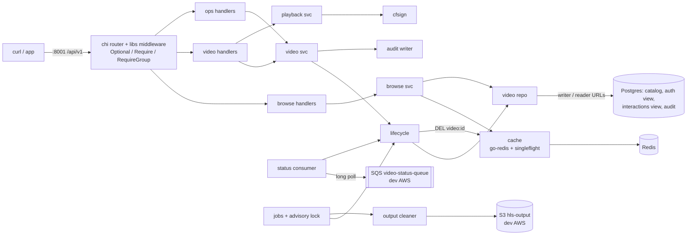

# Implementation Plan: Catalog service (sketch)

## Problem statement
Build the Go Catalog service in `services/catalog` as a working sketch, like the auth facade. Before that, create every database schema from Data Design §1 with local mock data. It covers all 10 Catalog endpoints, the `video-status-queue` consumer, and the three background jobs. Postgres and Redis run locally. SQS, SNS, S3 and CloudFront run in the AWS development stack.

## Requirements
- **Endpoints** (Interface Design §1.2, `openapi.yaml`). Paths start with `/api/v1`.

  | Route | Auth | Success | Notes |
  |-------|------|---------|-------|
  | `GET /feed?sort=recent\|most_viewed` | Public | 200 | `READY` only |
  | `GET /search?q=` | Public | 200 | `q` is 1–200 chars, plain words |
  | `GET /creators/{userId}/videos` | Public | 200 | 404 for an unknown creator |
  | `GET /videos/{videoId}` | Optional | 200 | Non-owners see only `READY`. The owner sees every status except `DELETED`, plus `status` and `failureReason` |
  | `GET /videos/{videoId}/playback` | Optional | 200 | 3 `Set-Cookie` lines, `Cache-Control: no-store`. A non-`READY` video returns 409 to its owner and 404 to everyone else |
  | `PATCH /videos/{videoId}` | Owner | 200 | `title` and/or `description`, unknown fields rejected. Not allowed on `DELETED` |
  | `DELETE /videos/{videoId}` | Owner | 204 | Soft delete. An already deleted video returns 404 |
  | `GET /me/videos` | JWT | 200 | Every status except `DELETED`, including `likeCount` and `commentCount` |
  | `POST /ops/videos/{id}/hide` | Operator | 204 | `READY` → `HIDDEN`, any other status returns 409 |
  | `POST /ops/videos/{id}/restore` | Operator | 204 | `HIDDEN` → `READY`, any other status returns 409 |

- **Pagination:** keyset cursors with `limit` 1–50 (default 20), returning `{items, nextCursor}`. No `OFFSET` (SCAL-06).
- **Lifecycle** (Architecture §2.3): one component changes `status`, and only forward. Duplicate events are acknowledged and do nothing.
- **Status consumer:** long-polls `video-status-queue`, handling `video.processing`, `video.ready` (`durationSeconds`, `renditions`, and `published_at` set on the first `READY`) and `video.failed` (`reason`).
- **Background jobs**, each run under `pg_try_advisory_xact_lock`:
  - every 15 min, `PENDING_UPLOAD` older than 24 h becomes `EXPIRED`;
  - every 15 min, `PROCESSING` older than 2 h becomes `FAILED`;
  - daily, HLS outputs of videos deleted more than 7 days ago are removed.
- **Caching** (Data Design §3.2): `feed:` and `search:` keys with a 30 s TTL, and `video:{id}` with a 60 s TTL, deleted on every write to that video. If Redis fails, reads go to Postgres.
- **Audit:** only `video.hidden` and `video.restored`, written in the same transaction as the status change (follows Data Design §1.3).
- **Data access:** reads use `DATABASE_READER_URL` (default: the writer) and writes use `DATABASE_URL`. pgx runs in `QueryExecModeExec`, with no session `SET`.
- **Ownership** comes only from the token `sub` (SEC-02). The `operators` check uses `cognito:groups`.

**User decisions**
- The scope is a sketch, like the auth plan.
- Build the full schema for every service first, with local mock data.
- SQS, SNS and S3 use the development stack through the standard AWS credential chain.
- CloudFront uses the real development distribution and key group.
- The cleanup job may delete from the development bucket.
- `/me/videos` excludes `DELETED`.
- The plan is saved as `CATALOG_SERVICE_PLAN.md` in the repo root, on branch `feat/catalog`.

**Out of scope** (the same gaps as auth):
- CI and the OpenAPI contract check
- OpenTelemetry and X-Ray
- Loading secrets from Secrets Manager (the private key comes from a PEM file path)
- Per-user rate limits and the circuit breaker
- Mapping RDS Proxy borrow timeouts to 503
- CORS for the web client
- ECS and Terraform wiring

## Background
- The pieces to reuse already exist in `libs/go`:
  - `config`, `problem`, `health` and `db` (pgxpool in `QueryExecModeExec`);
  - `redisclient`;
  - middleware for correlation id, logging, recover and `OriginVerify`;
  - `jwtauth.Require`.
- Shared middleware is missing two things: optional authentication and an operator-group check.
- The auth patterns to copy:
  - `cmd/<svc>/main.go`, which includes a `healthcheck` subcommand;
  - the `internal/http` package named `httpapi`;
  - an `internal/config` wrapper around `libconfig`;
  - the distroless Dockerfile built from the repo root with `GOWORK=off`;
  - the audit writer, which takes `details` as a string with an explicit `::jsonb` cast and uses no `RETURNING`;
  - a `replace` directive pointing at `libs/go`.
- `publish-images.yml` already builds `catalog`. The current `services/catalog/Dockerfile` is a placeholder.
- Each schema has its own `migrate-<schema>` one-shot and its own version table. The `initdb/` scripts run only when the Postgres volume is first created, so new roles need an idempotent bootstrap step.
- The auth migration expects consumer services to grant themselves `SELECT` on `auth.v_user_public`. That creates a cycle: Catalog reads `interactions.v_video_stats`, and Interactions reads `catalog.v_video_visibility`. **Resolution:** the schema that owns a view grants access on it to the roles that read it. All roles exist before any migration runs. This adds `auth/000002` and `audit/000002`, which grant the existing objects to the new roles.
- **CloudFront signing:** `feature/cloudfront/sign`, `NewCookieSigner(keyID, rsaKey)` and `SignWithPolicy`. The SDK cannot set `HttpOnly`, `Partitioned` or `Max-Age`, so they are added afterwards. The default SHA-1 hash is kept so exactly 3 cookies are returned (SHA-256 adds a fourth `CloudFront-Hash-Algorithm` cookie, which the contract does not allow).

**Decisions where the docs are silent or ambiguous**
1. **Out-of-order events.** SQS standard queues don't guarantee order, so `video.ready` and `video.failed` are also accepted from `PENDING_UPLOAD`. Without this, a `ready` that arrives before `processing` would be dropped, and the video would sit in `PROCESSING` until the 2 h sweep marks it `FAILED`. It still counts as a forward move. `EXPIRED` and `DELETED` ignore every event.
2. **Cleanup marker.** `catalog.videos` gets a column `outputs_purged_at timestamptz`. Without it, the daily job would list S3 again for every deleted video, forever. This adds to Data Design but does not change the API contract.
3. **Deleting `PENDING_UPLOAD` or `PROCESSING` videos** returns 409, following the state diagram.
4. **PATCH or DELETE by someone other than the owner:** 403 if the caller could see the video (it is `READY`), otherwise 404, so the existence of a video is never revealed.
5. **Local port 8001** for Catalog, since auth already uses 8000.
6. **`renditions`** is stored as `text[]`, with a check that limits values to `360p` and `720p`.

## Proposed solution



**Layout**
```
deploy/local/
  bootstrap/roles.sql          # idempotent: auth_svc, catalog_svc, interactions_svc, upload_svc
  seed/seed.sql                # local mock data, never in migrations/
  docker-compose.yml           # + bootstrap-roles, migrate-{catalog,interactions,upload}, seed, catalog
migrations/
  auth/000002_grant_public_view   audit/000002_grant_service_inserts
  catalog/000001_create_videos    interactions/000001_create_interactions   upload/000001_create_upload
libs/go/middleware/jwtauth/     # + Optional, RequireGroup
services/catalog/
  cmd/catalog/  cmd/send-event/  scripts/seed-media.sh
  internal/{config,video,cursor,store,cache,browse,lifecycle,playback,cfsign,events,jobs,storage,http}
```

## Task breakdown

**Task 0: Save the plan and create the branch**
- Objective: create `feat/catalog` and write this plan to `CATALOG_SERVICE_PLAN.md` in the repo root.
- Demo: the file exists on the branch.

**Task 1: Service roles and every schema migration**
- Objective: every table, enum, index, view and grant from Data Design §1 exists locally.
- Guidance:
  - `deploy/local/bootstrap/roles.sql` creates `catalog_svc`, `interactions_svc` and `upload_svc` with `DO $$ … IF NOT EXISTS`, plus `ALTER ROLE … SET search_path`, `statement_timeout` and `TimeZone`. Move `auth_svc` there as well. A `bootstrap-roles` one-shot (`postgres:16-alpine` running `psql`) runs it before every `migrate-*` container, so no volume wipe is needed. Keep `initdb/01-roles.sql` working, or have it point to the bootstrap script.
  - `catalog/000001` creates:
    - the enum `video_status` and the table `videos` with `CHECK` constraints on length, size ≤ 1 GB and renditions;
    - `description NOT NULL DEFAULT ''`;
    - the generated `search_vector` column with Spanish weights A and B;
    - `deleted_at` and `outputs_purged_at`;
    - the four indexes from §1.3;
    - the view `v_video_visibility`.
  - Grants for `catalog.videos`: `catalog_svc` gets `SELECT, UPDATE` (no INSERT or DELETE), and `upload_svc` gets `INSERT` only. Grant `SELECT` on `v_video_visibility` to `interactions_svc`.
  - `interactions/000001` creates `comments`, `likes`, `video_stats`, `reports`, the enums `report_target`, `report_reason` and `report_status`, the indexes (including the partial unique index on open reports), and the view `v_video_stats`. Grant `SELECT` on the view to `catalog_svc`.
  - `upload/000001` creates `upload_requests` with `UNIQUE (user_id, idempotency_key)` and `UNIQUE (video_id)`, plus `daily_quota` with the primary key `(user_id, day)`.
  - `auth/000002` grants `SELECT` on `v_user_public` to `catalog_svc` and `interactions_svc`. `audit/000002` grants `USAGE` and `INSERT` to both roles. Every migration gets a working `down` file.
  - Add `migrate-catalog`, `migrate-interactions` and `migrate-upload` to Compose, each depending on `bootstrap-roles`, with their own `x-migrations-table`.
- Tests:
  - run `up`, `down` and `up` again for each schema;
  - a SQL check script, `deploy/local/checks/grants.sql`, that confirms with `has_table_privilege` that `catalog_svc` cannot INSERT into `videos`, `upload_svc` cannot UPDATE it, and no role can UPDATE `audit_log`.
- Demo: `docker compose up` applies every migration on the existing volume, `\dt catalog.* interactions.* upload.*` lists all the tables, and the grants script passes.

**Task 2: Local mock data**
- Objective: a repeatable dataset that covers every Catalog case.
- Guidance:
  - `deploy/local/seed/seed.sql` uses fixed UUIDs and `ON CONFLICT DO NOTHING`, so it can run repeatedly. It runs as `postgres` in a `seed` one-shot after all migrations, and never in AWS.
  - Data:
    - about 5 `auth.users`;
    - about 30 videos covering every status, with Spanish titles and descriptions ("recorrido campus", "tutorial", accented words) for search;
    - a `FAILED` video with a reason;
    - `DELETED` videos with `deleted_at` 8 days ago;
    - `PENDING_UPLOAD` and `PROCESSING` videos older than 24 h and 2 h, so the jobs have work;
    - `video_stats` rows with varied counts, and a few `likes` and `comments`.
  - The psql variable `seed_owner_sub`, set from `SEED_OWNER_SUB` in the environment, gives about 8 videos in mixed statuses to the real Cognito test user. Owner routes can then be tested with a real token. If the variable is unset, those videos go to a fake user.
- Tests: the `seed` container runs twice without errors, and a check query counts the rows per status.
- Demo: `SELECT status, count(*) FROM catalog.videos GROUP BY 1` shows every status.

**Task 3: Catalog skeleton, auth middleware and container**
- Objective: the service starts, reports healthy, and every route exists as a 501 stub behind the correct auth.
- Guidance:
  - Create the `services/catalog` module and add it to `go.work`.
  - `internal/config` reads `PORT` (8001), the database writer and reader URLs, Redis, Cognito (pool and client ID), `CLOUDFRONT_DOMAIN`, `CLOUDFRONT_KEY_PAIR_ID`, `CLOUDFRONT_PRIVATE_KEY_FILE`, `AWS_REGION`, `VIDEO_STATUS_QUEUE_URL`, `HLS_OUTPUT_BUCKET`, the job intervals and thresholds, and the `CONSUMER_ENABLED` and `JOBS_ENABLED` flags.
  - Add two middleware to `libs/go/middleware/jwtauth`:
    - `Optional(v)`: with no header, the request continues as a guest; a header with an invalid token gets 401, as the contract lists for these routes.
    - `RequireGroup("operators")`: returns 403 if the group is missing.
  - The router copies the auth one, with route groups for Public, Optional, JWT and Operator. `/readyz` checks only the database.
  - Replace the placeholder Dockerfile with the auth pattern. Add a `catalog` service to Compose with `.env`, `~/.aws` mounted read-only with `AWS_PROFILE`, and the PEM file mounted read-only. Add a `.env.example`.
- Tests: config validation; `Optional` with no, valid and invalid tokens, and `RequireGroup`, using the existing `jwtauthtest` helper; and a router test that each route returns 401, 403 or 501 as expected.
- Demo: `curl :8001/readyz` returns 200, `GET /api/v1/feed` returns a 501 problem, and `POST /api/v1/ops/videos/x/hide` without a token returns 401.

**Task 4: Video domain, read repository and `GET /videos/{id}`**
- Objective: the first real endpoint, including the visibility rules.
- Guidance:
  - `internal/video`: the `Video` type, the `Status` constants, and title and description validation (rune count; title trimmed and non-empty).
  - `internal/store`: separate writer and reader pools. `GetByID` reads `videos` with a LEFT JOIN on `auth.v_user_public` (placeholder display name if the user row is missing) and a LEFT JOIN on `interactions.v_video_stats` (`COALESCE` to 0).
  - Visibility in `internal/video.Service`:
    - a non-owner gets 404 unless the video is `READY`;
    - the owner gets 404 only for `DELETED`;
    - a malformed UUID returns 404.
  - Media fields (`thumbnailUrl`, `durationSeconds`, `renditions`, `publishedAt`) are null or empty until the video is `READY`. The owner also gets `status` and `failureReason`.
- Tests: a unit-test table covering every combination of status and viewer type against a fake repository; repository integration tests against the seed (build tag `integration`); and a grants integration test that connects as `catalog_svc` and confirms INSERT fails.
- Demo: a seeded `READY` video returns 200 as a guest. A `FAILED` video owned by `SEED_OWNER_SUB` returns 404 as a guest and 200 with the owner's token, including `failureReason`.

**Task 5: Cursors, feeds and creator pages**
- Objective: `GET /feed` (both sorts) and `GET /creators/{userId}/videos`.
- Guidance:
  - `internal/cursor`: base64url JSON `{s: sortKind, k: key, id}`. A malformed cursor, or one from a different sort, gets 400 with `errors[]`.
  - The `recent` sort uses `(published_at, id) < ($k, $id)`, and `most_viewed` uses `(COALESCE(view_count,0), id)`. Both fetch `limit+1` rows to decide `nextCursor`.
  - Creator pages return 404 when the user is not in `v_user_public`.
  - The `limit` parameter is validated to 1–50.
- Tests: cursor round-trip and tamper cases; pagination integration tests that walk every page with `limit=7`, with no duplicates or gaps, while a new `READY` row is inserted halfway through.
- Demo: page through `/feed?sort=most_viewed&limit=5` with `curl … | jq .nextCursor`.

**Task 6: Search**
- Objective: `GET /search?q=` with Spanish ranking.
- Guidance: use `plainto_tsquery('spanish', $q)` and `ts_rank(search_vector, q)`. The cursor is `(rank, id)`, with `rank` kept as `float4` in both the comparison and the cursor so they match exactly. `q` must be 1–200 characters. No results returns 200 with empty `items`.
- Tests: stemming (`recorridos` matches `recorrido`), a title match ranks above a description match, query-syntax characters are treated as plain words, and pagination is stable.
- Demo: `/search?q=recorridos%20campus` returns the seeded video whose title matches first.

**Task 7: Feed and detail cache**
- Objective: cache-aside caching as in Data Design §3.2.
- Guidance:
  - `internal/cache` stores JSON pages under the keys `feed:{sort}:{cursor}:{limit}` and `search:{sha256(q)}:{cursor}:{limit}` (30 s), and `video:{id}` (60 s, only the public view of `READY` videos; owner views are not cached).
  - A `singleflight.Group` per key collapses concurrent misses. Any Redis error is logged at warn level and the request goes to Postgres.
  - Add an `Invalidate(videoID)` method; Task 8 wires it.
- Tests: hit and miss with miniredis, or Compose Redis under the integration tag; singleflight collapses 50 concurrent misses into one repository call; with Redis stopped, the request still returns 200.
- Demo: two identical `/feed` calls, where the second touches no rows (visible in the query log). After `docker compose stop redis`, `/feed` still works.

**Task 8: Lifecycle, studio list, edit and delete**
- Objective: the state machine, plus `GET /me/videos`, `PATCH` and `DELETE`.
- Guidance:
  - `internal/lifecycle` holds a pure transition table with the actions `processing`, `ready`, `fail`, `expire`, `timeout`, `hide`, `restore` and `delete`. It returns the allowed source statuses and the column changes.
  - It runs `UPDATE … WHERE id=$1 AND status = ANY($from)` on a given transaction. When no row changes, it reads the current status to return `ErrNotFound`, `ErrNoop` (duplicate) or `ErrConflict`. On success it calls `cache.Invalidate`.
  - `ready` sets `published_at = COALESCE(published_at, now())`, and `delete` sets `deleted_at`.
  - `/me/videos` sorts by `(created_at DESC, id)`, excludes `DELETED`, and includes like and comment counts.
  - `PATCH` uses `DisallowUnknownFields`, requires at least one field, bumps `updated_at` and invalidates the cache. The 403-or-404 rule for non-owners is in decision 4 above.
- Tests: table tests on the transition table covering every status and action pair; integration tests for the conditional update under concurrency (two deletes give one 204 and one 404); handler tests for each status code.
- Demo: with the owner's token, list `/me/videos`, rename a video, and delete it. It then disappears from `/feed` and returns 404 on `GET`.

**Task 9: Operator hide and restore**
- Objective: `/ops/videos/{id}/hide` and `/restore` with an audit row.
- Guidance: the lifecycle transition and the audit `INSERT` (`video.hidden` or `video.restored`, with the actor set to the operator `sub`) run in one transaction. The audit writer is copied from auth and accepts a `pgx.Tx`.
- Tests: a rollback test where an audit failure leaves the status unchanged; 409 on wrong statuses; 403 for a user who is not an operator.
- Demo: the operator test user hides a `READY` video, which then disappears from the feed and returns 404 for guests. `audit.audit_log` has the row, and a restore brings the video back.

**Task 10: Status event consumer (dev SQS)**
- Objective: `video.*` events move videos through the lifecycle.
- Guidance:
  - `internal/events` parses the envelope and validates `type`, `videoId` and `data`. A goroutine long-polls (`WaitTimeSeconds=20`, up to 10 messages) and stops on SIGTERM.
  - Message handling:
    - on success or `ErrNoop`, delete the message;
    - for an unknown video, log a warning and delete the message;
    - for an unparseable message or a database error, leave it alone, so it is retried and eventually reaches the DLQ.
  - `cmd/send-event` is a dev tool that publishes an envelope to the SNS `video-events` topic, with `--sqs` to send straight to the queue.
- Tests: the handler against a fake SQS interface, covering each outcome above; a duplicate `ready` is a no-op; `ready` before `processing` is accepted.
- Demo: `send-event --type video.processing --video <seeded PENDING id>` and then `--type video.ready --duration 30 --renditions 360p,720p`. The video appears in `/feed`. Sending `ready` again is ignored.

**Task 11: Expiry and stuck-state jobs**
- Objective: periodic jobs that change status, safe to run on several tasks at once.
- Guidance:
  - `internal/jobs.Runner` uses a ticker with jitter. Each run opens a transaction, calls `pg_try_advisory_xact_lock(<per-job key>)` and skips the run if the lock is taken.
  - The expiry job handles at most 100 rows per run through the lifecycle (`expire`). The sweep job does the same with `timeout`, using the reason "processing timed out".
  - Intervals and thresholds are configurable, so the demo can run every 10 s.
- Tests: integration tests with two runners at once, where only one does the work; the batch limit is respected; videos younger than the threshold are left alone.
- Demo: with `JOB_INTERVAL=10s`, the seeded stale `PENDING_UPLOAD` and `PROCESSING` videos become `EXPIRED` and `FAILED` within seconds.

**Task 12: Signed playback (dev CloudFront)**
- Objective: `GET /videos/{id}/playback` returns cookies that the real distribution accepts.
- Guidance:
  - `internal/cfsign` loads the PEM file with `sign.LoadPEMPrivKeyFile`. It builds a custom policy for `https://{domain}/videos/{id}/*` with `DateLessThan` set to now + 2 h, then signs it with `SignWithPolicy`. It then sets `Path=/videos/{id}/`, `Secure`, `HttpOnly`, `SameSite=None`, `Partitioned` and `MaxAge=7200` on each cookie.
  - `internal/playback` checks visibility as in Task 4. The owner of a non-`READY` video gets 409. The response body has the cookies map, `expiresAt` and `masterPlaylistUrl`, with `Cache-Control: no-store`.
  - `scripts/seed-media.sh` uses `ffmpeg` (testsrc, 10 s) and the `aws` CLI to upload an HLS master, 360p and 720p variants, and a thumbnail for 2 seeded `READY` video ids in the development bucket.
- Tests: verify the signature with the public key; check the policy JSON for resource and expiry; check the cookie attributes and that exactly 3 cookies are returned; handler tests for 404 and 409.
- Demo: `curl` the playback endpoint, then `curl -H "Cookie: CloudFront-Policy=…; CloudFront-Signature=…; CloudFront-Key-Pair-Id=…" https://<domain>/videos/<id>/master.m3u8` returns 200, and the same request without cookies returns 403. The thumbnail URL works unsigned.

**Task 13: HLS output cleanup job (dev S3)**
- Objective: remove the outputs of deleted videos after the retention period.
- Guidance:
  - `internal/storage` paginates `ListObjectsV2` over `videos/{id}/`, deletes in `DeleteObjects` batches of up to 1,000, and also deletes `thumbnails/{id}.jpg`.
  - The job selects `status='DELETED' AND outputs_purged_at IS NULL AND deleted_at < now() - retention`, in batches of 20 under the advisory lock, and sets `outputs_purged_at` after a successful delete.
  - Missing objects count as success.
- Tests: the S3 adapter against a fake client (pagination, the 1,000-object batching, a missing prefix); job integration tests with the fake storage.
- Demo: delete one of the seed-media videos and set `OUTPUT_RETENTION=1m`. After the next run, `aws s3 ls s3://<bucket>/videos/<id>/` is empty and `outputs_purged_at` is set.

**Task 14: README, Compose walkthrough and diagram sync**
- Objective: the next developer can run the whole thing.
- Guidance:
  - `services/catalog/README.md` covers the endpoints table, behavior notes (decisions 1–6), the environment variables, and the AWS dev resources and IAM permissions needed. The permissions are: SQS receive and delete; S3 `ListBucket` and `DeleteObject`; `sns:Publish` and S3 `PutObject` for the dev tools only.
  - It also has a curl walkthrough from seed to feed, search, detail, playback, studio edit and delete, ops hide and restore, events and jobs, plus the known gaps.
  - Update `c4-level3-catalog.puml` if any package names changed, and re-render it.
- Demo: `docker compose up` followed by the README walkthrough runs end to end.

---

**Inputs needed from the user, and by when:**
- **Before Task 2:** the test user's Cognito `sub` (`SEED_OWNER_SUB`), and a test user in the `operators` group.
- **Before Task 10:** the AWS profile and region, the URLs of the `video-status-queue` and its DLQ, and the ARN of `video-events`, with raw message delivery confirmed on.
- **Before Task 12:** the CloudFront domain, the public key ID, the private key PEM, and the `hls-output` bucket name. `ffmpeg` and the `aws` CLI must be installed locally.
