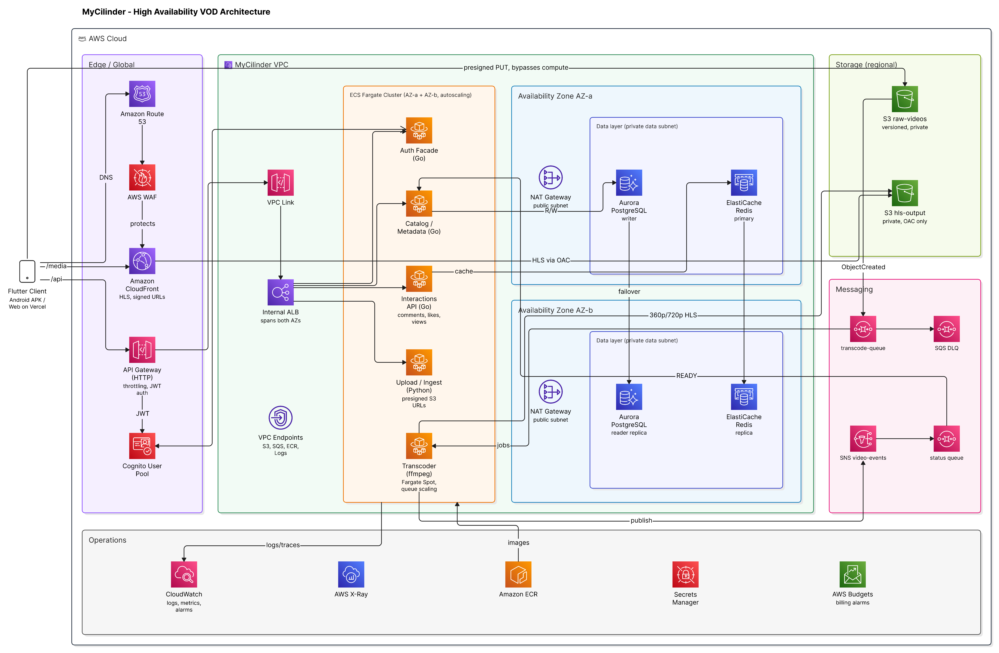

# MyCilinder

Scalable video-on-demand (VOD) streaming platform — analogous to YouTube's core experience: upload, transcode, browse, watch, and interact (comments, likes).

> **Course context:** ITESO — Sistemas Escalables. Detailed artifacts live under [`docs/`](./docs) (requirement specification, design description, testing plan, OpenAPI).

---

## 1. Overview

MyCilinder is a streaming application available on Android/web (Flutter client) that lets users upload, share, browse, and watch videos, and interact with them through comments and likes.

The platform is **designed on paper to serve 100,000–1,000,000+ daily active users (DAU)**. The architecture, data model, and service boundaries are all chosen to be horizontally scalable to that range. However, the project runs on **AWS school credits (~100–140 credits, free-tier oriented)**, so the *deployed* environment is intentionally run at a **throttled, demo scale**. The design proves it *can* scale; the deployment proves it *works*. This gap is explicit and managed — see the risk matrix (§5).

### 1.1 Scope (MVP)

**In scope**
- User registration / authentication (AWS Cognito).
- Video upload with asynchronous transcoding to adaptive bitrate (HLS).
- On-demand playback via CDN.
- Browse / search / video detail pages.
- Social interactions: comments, likes, view counts.
- Basic creator view (my uploads, processing status).

**Out of scope (MVP)**
- Live streaming.
- Monetization / ads.
- Recommendations / personalized feed (beyond simple "most viewed / recent").
- Content moderation beyond basic reporting hooks.
- Mobile-native playback DRM.

### 1.2 Repositories (polyrepo)

| Repo | Responsibility | Primary tooling |
|------|----------------|-----------------|
| `MyCilinder-Infra` | All cloud infrastructure as code | **Terraform** |
| `MyCilinder-Backend` *(this repo)* | Microservices, APIs, media pipeline workers | Polyglot (see §6) |
| `MyCilinder-Frontend` | Android + web client | **Flutter** |

---

## 2. Objectives

### 2.1 Business / academic objectives
- **O1** — Deliver a working VOD MVP demonstrating the full upload → transcode → playback loop end to end.
- **O2** — Demonstrate an architecture that is *credibly* scalable to 100k–1M DAU on paper, with the reasoning documented.
- **O3** — Stay within the AWS school credit budget throughout development and demo.
- **O4** — Produce professional-grade documentation (requirements, design, testing) following a waterfall process.

### 2.2 Technical / non-functional objectives

| ID | Objective | Target (design intent) |
|----|-----------|------------------------|
| NFR1 | **Scalability** | Stateless services behind autoscaling; no single-node bottleneck in the request path. Design for 1M DAU; deploy throttled. |
| NFR2 | **Availability** | Core read/playback path target 99.9% (multi-AZ). Upload/transcode may be best-effort async. |
| NFR3 | **Latency** | Playback start (CDN cache hit) < 2 s; API reads (p95) < 300 ms. |
| NFR4 | **Durability** | No loss of uploaded source media (S3 11-nines durability). |
| NFR5 | **Cost control** | Hard guardrails + budget alarms; data path kept off compute wherever possible. |
| NFR6 | **Security** | Managed auth (Cognito), least-privilege IAM, no public write buckets, signed URLs for media. |
| NFR7 | **Observability** | Centralized logs/metrics/traces; every service emits health + key business metrics. |

---

## 3. Architecture (high level)

**Style:** microservices, stateless where possible, communicating over HTTP (synchronous) and SQS/SNS/EventBridge (asynchronous). The **media data path is kept off the application compute** — clients upload directly to S3 via presigned URLs and play back through CloudFront. Services only handle metadata and orchestration.



*Figure 1 — Target (design-scale) architecture. The deployed demo runs a throttled subset of this topology (see "Design scale vs. demo scale" below).*

**Upload → playback flow**
1. Client requests a presigned upload URL from the Upload service.
2. Client PUTs the raw file **directly to S3** (API never touches the bytes).
3. S3 `ObjectCreated` event → SQS → Transcoder worker.
4. Worker produces adaptive-bitrate HLS renditions, writes them to the output bucket, updates metadata status to `READY`.
5. Viewers stream HLS via CloudFront; the API only serves metadata + signed playback URLs.

### 3.1 Architecture drivers

- **Highly available read/playback path:** every component on it is a managed, multi-AZ service; no single instance or AZ in the request path.
- **Scalable by design:** stateless containers behind autoscaling, a CDN for media, and a cache plus read replica for metadata.
- **Media stays off compute:** presigned PUT in, CloudFront out; services only handle metadata and orchestration.
- **Cost-aware:** transcoding runs on Fargate Spot, scaled by queue depth, with capped renditions and input length.
- **Secure by default:** JWT validated at the edge, all compute and data in private subnets, private buckets.

### 3.2 Component description

**Edge (global services)**
- **Route 53** resolves the public domain; **AWS WAF** protects CloudFront and API Gateway with managed and rate-based rules.
- **CloudFront** is the only playback entry point. It caches HLS manifests and segments, enforces signed URLs, and reads the private output bucket through Origin Access Control (OAC).
- **API Gateway (HTTP API)** is the single API entry point. It applies throttling, validates the **Cognito** JWT, and forwards traffic to the VPC through a **VPC Link**.

**Network (VPC across two Availability Zones)**
- Three subnet tiers per AZ: **public** (NAT Gateway), **private-app** (ECS tasks), and **private-data** (Aurora, Redis, no internet route).
- An **internal ALB** spans both AZs and routes by path prefix to the ECS services; it is reachable only through the VPC Link.
- **VPC endpoints** (S3, SQS, ECR, CloudWatch Logs) keep AWS traffic private and reduce NAT cost.

**Compute (ECS Fargate, tasks spread across both AZs)**

| Service | Lang | Responsibility | Scaling signal |
|---------|------|----------------|----------------|
| Auth facade | Go | Register/login/refresh over Cognito; stable `/auth` contract for the client | CPU / requests |
| Catalog / Metadata API | Go | Videos, feed, search, video detail; consumes `READY` status events | CPU / requests |
| Interactions API | Go | Comments, likes, views; counters kept in Redis and flushed asynchronously to Aurora | CPU / requests |
| Upload / Ingest API | Python | Validates quotas, creates the video record, returns the presigned S3 PUT URL | CPU / requests |
| Transcoder worker | Python + ffmpeg | Consumes the transcode queue, produces 360p/720p HLS, publishes a `video-events` message | Queue depth (Spot) |

**Data, storage, and messaging**
- **S3 `raw-videos`** (versioned, private) receives uploads via presigned URLs; **S3 `hls-output`** (private) is readable only through CloudFront.
- **Aurora PostgreSQL** has a writer in AZ-a and a reader replica in AZ-b with automatic failover. **ElastiCache Redis** has a primary and replica in separate AZs and holds the hot feed cache and counters.
- S3 `ObjectCreated` feeds the **SQS `transcode-queue`** (with a dead-letter queue). On completion the worker publishes to the **SNS `video-events`** topic; a subscribed SQS queue lets Catalog mark the video `READY` or `FAILED`.

**Operations:** CloudWatch (logs, metrics, alarms) and X-Ray (traces) receive data from every service; ECR stores images, Secrets Manager holds credentials, and AWS Budgets raises billing alarms.

### 3.3 High-availability strategy

The key decision is that **playback does not depend on the VPC, the containers, or the database**: once a client has a signed URL, delivery is CloudFront → S3 only. An application-tier failure degrades browsing and interactions but not videos already playing.

| Failure scenario | Behavior |
|------------------|----------|
| Single Fargate task fails | The ALB health check removes it and ECS replaces it; other tasks keep serving. |
| Entire AZ unavailable | Traffic shifts to tasks in the other AZ; Aurora promotes its replica and Redis fails over. Clients retry with backoff during failover. |
| Redis unavailable | Catalog falls back to Aurora (slower, still correct); Interactions buffers counter updates briefly. |
| Transcoder crash or Spot interruption | The SQS message becomes visible again and is retried; repeated failures go to the DLQ and raise an alarm. Raw objects are retained, so any video can be re-queued. |
| Upload spike | SQS absorbs the burst and the worker fleet scales on queue depth, up to a maximum that protects the budget. Playback is unaffected. |

Durability: S3 provides 11-nines durability with versioning on the raw bucket, and Aurora has continuous backups with point-in-time recovery. The design is **single-region**; multi-region is listed under Future work (§7).

### 3.4 Scalability and security

- **Scalability:** services are stateless and scale horizontally behind the ALB; CloudFront, Redis, and Aurora readers absorb read load; like/view counters are batched into Aurora to avoid write hotspots; transcoding scales out and back to zero on queue depth. Known limits at 1M DAU: search should move to OpenSearch and comment writes may need sharding (§7).
- **Security:** the only public surfaces are CloudFront and API Gateway, both behind WAF. Each ECS service has its own least-privilege task role, data is encrypted at rest and in transit, and secrets live in Secrets Manager.

---

## 4. Project organization (Waterfall)

The project follows a classic **waterfall** lifecycle. Each phase has a gate (exit criteria + sign-off) before the next begins. Calendar dates are deliberately deferred for now; the sequence and deliverables are fixed.

| Phase | Deliverable(s) | Exit gate |
|-------|----------------|-----------|
| **1. Requirements** | `docs/requirement-specification` — functional + non-functional requirements, user stories, acceptance criteria | Requirements reviewed & signed off |
| **2. Design** | `docs/design-description` — system architecture, service boundaries, data model (ERD), API contract (`docs/openapi.yaml`), infra topology | Design reviewed; APIs frozen |
| **3. Implementation** | Backend services, Terraform infra, Flutter client | Feature-complete against frozen scope |
| **4. Testing** | `docs/testing-plan` — unit, integration, end-to-end, basic load test; defect log | All critical/high defects closed |
| **5. Deployment** | Running demo environment on AWS, within budget; frontend demo surface decided (see note) | Demo validated end to end |
| **6. Maintenance / closeout** | Final report, lessons learned, teardown of billable resources | Resources torn down; retrospective done |

**Roles:** 
- Developer 1: Diego  Gomez
- Developer 2: Dario Lucciano
- Developer 3: Alexis Flores

**Governance:** API contract (`openapi.yaml`) is the single source of truth and is frozen at the end of Design. Changes after freeze require a documented change request.

**Frontend demo delivery:** the backend and media infrastructure run on AWS regardless. For the client, if we need a hosted **web** build of the Flutter app it will be deployed to **Vercel (free tier)** — this keeps the frontend off the AWS credit budget. Otherwise, the demo will be given with the **Android app sideloaded** (installed directly from an APK). Either path consumes the same backend APIs.

---

## 5. Risk management plan

### 5.1 Scoring

- **Likelihood (L):** 1 Rare · 2 Unlikely · 3 Possible · 4 Likely · 5 Almost certain
- **Impact (I):** 1 Negligible · 2 Minor · 3 Moderate · 4 Major · 5 Severe
- **Score = L × I.** 1–6 Low · 8–12 Medium · 15–25 High.

### 5.2 Risk matrix

| # | Risk | Category | L | I | Score | Severity | Mitigation | Contingency |
|---|------|----------|---|---|-------|----------|------------|-------------|
| R1 | **AWS credits exhausted** by transcoding + CDN egress | Cost | 4 | 5 | 20 | **High** | Keep data path off compute; cap video resolution/length; prefer `ffmpeg` on spot/Fargate over MediaConvert if cheaper; AWS Budgets alarms at 50/75/90%; nightly cost review | Freeze non-essential services; serve from S3 directly without CDN for demo; teardown idle resources |
| R2 | **Transcoding is slow/expensive** at scale | Technical | 4 | 4 | 16 | **High** | Async queue (SQS) decouples upload from processing; limit renditions (e.g., 360p/720p only for MVP); cap input duration | Process a curated demo set offline; show pipeline on small files |
| R3 | **Scope creep** (live streaming, recommendations, moderation) | Project | 1 | 3 | 12 | Medium | Scope frozen in §1.1; change requests required post-Design freeze | Defer to "future work" section |
| R4 | **Polyglot coordination overhead** (3 languages) | Technical/Team | 3 | 3 | 9 | Medium | Deliberately small split (§6); shared OpenAPI contract; containerize every service identically | Consolidate a struggling service into the team's strongest language |
| R5 | **Waterfall late-integration failure** | Process | 3 | 4 | 12 | Medium | Walking-skeleton end-to-end first; API frozen early | Reserve integration buffer before Testing gate |
| R6 | **Cognito lock-in / limited UX customization** | Technical | 2 | 2 | 4 | Low | Abstract auth behind our own `/auth` facade so client isn't coupled to Cognito SDK specifics | Swap provider behind the facade if needed |
| R7 | **Security misconfiguration** (public buckets, open IAM) | Security | 3 | 5 | 15 | **High** | Terraform-only infra (reviewed), no public write, signed URLs, least-privilege IAM, `tfsec`/checkov in CI | Rotate credentials; lock down and re-provision |
| R8 | **Team member unavailability** (school project) | Team | 3 | 3 | 9 | Medium | Service ownership documented + a backup owner each; small services | Redistribute ownership; cut lowest-priority service |
| R9 | **Data loss of source uploads** | Technical | 1 | 5 | 5 | Low | S3 versioning on raw bucket; raw media never deleted by pipeline | Reprocess from retained raw objects |
| R10 | **Unexpected traffic/cost spike** (abuse, runaway loop) | Cost/Ops | 2 | 4 | 8 | Medium | Rate limiting at API Gateway; upload quotas; billing alarms | Throttle/disable upload; investigate before re-enabling |

**Top risks to watch:** R1, R2, R7 (all High). The first two are the direct consequence of doing video on a fixed micro-budget; R7 is the classic cloud footgun. These three drive the most important design decisions.

---

## 6. Technology selection & stack

### 6.1 Guiding principles
- **Keep the media data path off application compute** (presigned S3 uploads, CloudFront delivery). This is the #1 cost and scalability lever.
- **Managed over self-hosted** wherever the free tier allows — less ops burden for a student team.
- **Polyglot, but deliberately minimal:** two languages, each chosen for a clear reason..

### 6.2 Backend languages (per module)

| Module | Language | Why |
|--------|----------|-----|
| **Catalog / Metadata API** (videos, feed, search) | **Go** | High-throughput, low-latency read path; cheap concurrency; small memory footprint keeps compute cost down — matters directly for the credit budget. |
| **Interactions** (comments, likes, view counts) | **Go** | Same hot-path/concurrency reasons; counters + fan-out benefit from Go's lightweight goroutines. |
| **Upload / Ingest + Transcoder worker** | **Python** | Rich media ecosystem (ffmpeg bindings, boto3, MediaConvert SDK); this path is async and not latency-critical, so Python's throughput ceiling is irrelevant here. |
| **(Shared) Auth facade** | thin service in **Go** (or Python) | Wraps Cognito so the client never couples to the provider directly (mitigates R6). |


### 6.3 Full stack

| Layer | Choice | Notes |
|-------|--------|-------|
| **Client** | Flutter (web + Android) | Separate repo. HLS playback via platform players. |
| **Auth** | **AWS Cognito** | 50k MAU free tier; native API Gateway/ALB integration; JWT. Fronted by our auth facade. |
| **API edge** | API Gateway **or** ALB | API Gateway for managed auth + throttling; ALB if services run on ECS behind a single LB. |
| **Compute** | **ECS Fargate** (containers) | Stateless services; scales to zero/low for demo. Avoids EC2 management. |
| **Async messaging** | **SQS** (+ SNS/EventBridge) | Decouples upload from transcoding; buffers spikes. |
| **Object storage** | **S3** | Separate `raw` (versioned) and `output` (HLS) buckets. No public write. |
| **Transcoding** | **AWS MediaConvert** *or* **ffmpeg on Fargate** | Decide by cost during Design; ffmpeg-on-Fargate likely cheaper for the budget. |
| **CDN** | **CloudFront** | Signed URLs; caches HLS segments; the main playback path. |
| **Relational DB** | **RDS PostgreSQL** (Aurora Serverless v2 if credits allow) | Users, videos, comments metadata. |
| **Cache / counters** | **ElastiCache Redis** (or DynamoDB) | View counts, like counts, hot feed cache. |
| **Search** | PostgreSQL full-text (MVP) → OpenSearch later | Keep it cheap for MVP. |
| **IaC** | **Terraform** | Separate repo; `tfsec`/checkov in CI (R7). |
| **CI/CD** | GitHub Actions | Build/test/containerize per service; Terraform plan/apply gated. |
| **Observability** | CloudWatch (logs/metrics/alarms) + X-Ray | Billing alarms are mandatory (R1). |
| **Container registry** | ECR | Per-service images. |

### 6.4 Deliberate cost-driven simplifications
- MVP transcodes to **two renditions (360p/720p)**, not a full ABR ladder.
- **Input caps** on duration/resolution to bound transcode cost (R2).
- Full-text search in Postgres before adopting OpenSearch.
- Services scale down aggressively between demos.

---

## 7. Future work (post-MVP)
- Live streaming (IVS or MediaLive).
- Recommendation feed and personalized ranking.
- Content moderation pipeline.
- Full ABR ladder + per-title encoding.
- Multi-region active-active for true 1M-DAU production.

---

## 8. Repository layout (this repo)

```
MyCilinder-Backend/
├── README.md
└── docs/
    ├── requirement-specification/
    │   ├── overall-description.md
    │   ├── functional-requirements.md
    │   └── non-functional-requirements.md
    ├── design-description/
    ├── testing-plan/
    └── openapi.yaml
```