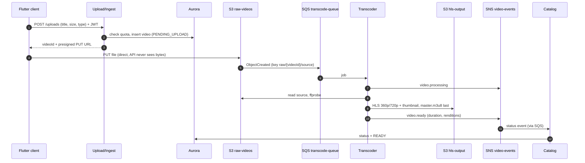
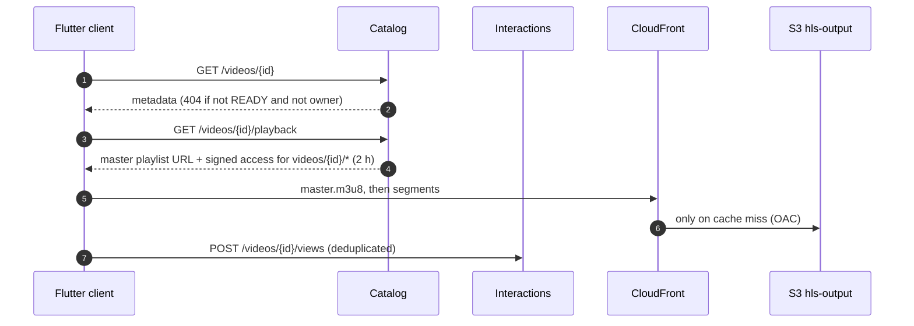

# Design Description: Architecture and Components

Part of the MyCilinder Software Design Description (SDD).
Related: [Overview](./overview.md) · [Data Design](./data-design.md) · [Interface Design](./interface-design.md) · [Requirement Specification](../requirement-specification/overall-description.md) · [Project charter](../../README.md)

**Conventions**
- The **baseline** is README §3 and [`diagrams/architecture.png`](../diagrams/architecture.png). The README already describes each component (§3.2), the HA behavior (§3.3), and the stack (§6.3). This document does not repeat them. It adds the decisions the baseline leaves open.
- Items marked *Proposed* are listed in §5 and need a team decision before the Design gate.

---

## 1. Architectural Pattern

**Microservices on containers (ECS Fargate) with an event-driven media pipeline**, fronted by managed edge services. Five stateless services communicate synchronously through one entry point and asynchronously through SQS and SNS. The media data path never touches application compute.

| Alternative | Why not |
|-------------|---------|
| Monolith | Simpler at demo scale, but it cannot scale the queue-driven, Spot-based transcoder independently of the request-driven API, and it hides the service boundaries the course asks the team to design. |
| Serverless functions | Fits the budget, but the team chose containers for uniform Go and Python packaging (R4), and transcoding exceeds practical function limits. |
| **Microservices on Fargate** | Independent scaling signals per service, no instance management. The cost is more moving parts, contained by the contract-first approach and CI/CD. |

**Rules that follow from the pattern**
1. **Synchronous path:** client → API Gateway → VPC Link → internal ALB → service. Services do not call each other synchronously on the read path, so one outage does not cascade (REL-12).
2. **Asynchronous path:** S3 `ObjectCreated` → SQS → Transcoder → SNS `video-events` → status queue → Catalog. All consumers are idempotent (REL-14).
3. **Single writer per table.** One Aurora cluster, one schema per service. A service writes only its own schema; others read it through documented read-only views (Data Design). *Proposed*, F4.
4. **The client composes.** Video detail (Catalog) and counts or comments (Interactions) are separate calls, so browsing and playback survive an Interactions outage.

---

## 2. System Diagrams

*Figure 1: target architecture. The demo runs a throttled subset. C4 diagrams will be added under `docs/diagrams/` `[TBC]`.*

### 2.1 Request routing

The ALB routes by path prefix. The final paths are defined in [`openapi.yaml`](../openapi.yaml). Where one resource spans services (such as `/videos/{id}/comments`), ALB rules use wildcard patterns with explicit priorities.

| Path (indicative) | Service | Auth |
|-------------------|---------|------|
| `/auth/*` | Auth facade | Public |
| `/uploads/*` | Upload / Ingest | JWT |
| `/videos/*/comments*`, `/videos/*/likes*`, `/videos/*/views*`, `/reports*` | Interactions | Reads public, writes JWT |
| `/videos/*`, `/feed/*`, `/search`, `/creators/*`, `/me/videos*` | Catalog | Reads public, own videos JWT |
| `/ops/*` | Catalog (hide / restore, report review) | JWT plus operator group claim |

### 2.2 Key flows

**Upload to ready** (FR-UP, FR-TR)

**Watch** (FR-PB)

All API calls also pass through API Gateway, the VPC Link, and the ALB (omitted for readability).

### 2.3 Video state ownership

Each lifecycle transition (Functional Requirements §1.0) has exactly one actor. Catalog accepts a transition only if it moves forward, so duplicate or out-of-order events are ignored.

| Transition | Actor | Trigger |
|------------|-------|---------|
| (none) → `PENDING_UPLOAD` | Upload / Ingest | `POST /uploads` accepted |
| `PENDING_UPLOAD` → `PROCESSING` | Catalog | `video.processing` event (see F4 about `UPLOADED`) |
| `PROCESSING` → `READY` / `FAILED` | Catalog | `video.ready` / `video.failed` event |
| `PENDING_UPLOAD` → expired | Catalog job | Older than 24 h (FR-UP-08) |
| `READY` ↔ `HIDDEN` | Catalog | Operator call on `/ops/*` |
| `READY` → `DELETED` | Catalog | Owner call (soft delete, BR-05) |

---

## 3. Technology Stack

Platform choices are in README §6.3, with two decisions settled in the [Overview](./overview.md) §2.5: region `us-east-1` and ffmpeg on Fargate Spot. The charter fixes only the languages (C-04), so the libraries below are *Proposed* defaults `[TBC]`.

| Area | Go services (Auth, Catalog, Interactions) | Python services (Upload/Ingest, Transcoder) |
|------|-------------------------------------------|---------------------------------------------|
| HTTP | `net/http` with `chi` | FastAPI (Upload). The Transcoder has no HTTP API. |
| PostgreSQL / Redis | `pgx` / `go-redis` | `psycopg` (v3) / not used |
| AWS | AWS SDK for Go v2 | `boto3` |
| Logging, tracing | `log/slog` (JSON), OpenTelemetry to X-Ray | `structlog` or `logging` (JSON), OpenTelemetry to X-Ray |
| Lint, tests (MAINT-10) | `gofmt`, `golangci-lint`, `go test` | `ruff`, `black`, type checking, `pytest` |
| Media | not used | `ffmpeg` / `ffprobe` as subprocesses (bundled in the worker image) |

API contracts are validated against `openapi.yaml` in CI (MAINT-01).

---

## 4. Module Breakdown

### 4.1 Services

Responsibilities per service are in README §3.2 and the FR areas below. This table adds data ownership.

| Service | Lang | Owns | FR area | Reads (read-only views) |
|---------|------|------|---------|-------------------------|
| **Auth facade** | Go | `users` (profile keyed by Cognito `sub`) | FR-AUTH | none |
| **Catalog / Metadata** | Go | `videos` | FR-PB, FR-BR, FR-CR, FR-MOD-04 | `users`, `video_stats` |
| **Interactions** | Go | `comments`, `likes`, `video_stats`, `reports` | FR-IN, FR-MOD-01..03 | `videos` (existence, visibility) |
| **Upload / Ingest** | Python | `upload_requests` (quota, idempotency keys); inserts the initial `videos` row | FR-UP | none |
| **Transcoder** | Python + ffmpeg | nothing; no database access | FR-TR | S3, SQS |

### 4.2 Design detail per service

**Auth facade.** Public routes (register, login, refresh, password reset) bypass the API Gateway JWT authorizer and are throttled (SEC-09). The profile row is created on first login (FR-AUTH-05).

**Catalog.**
- *Feeds and search:* cache-aside in Redis with short TTLs and single-flight against stampedes; falls back to the Aurora reader when Redis is down.
- *Playback access:* checks visibility (`HIDDEN`, `DELETED`, unknown return 404 to non-owners), then returns the master playlist URL and CloudFront access scoped to `videos/{videoId}/*`, valid 2 hours. The signing key is in Secrets Manager.
- *Status consumer:* long-polls the status queue and applies the forward-only state machine (§2.3).
- *Background jobs:* pending-upload expiry and a stuck-state sweep. They run in every task under a PostgreSQL advisory lock, so only one instance works at a time and no scheduler is needed (*Proposed*, F7).

**Interactions.**
- *Likes:* the `likes` row is the source of truth; `INSERT … ON CONFLICT DO NOTHING` on `(user, video)` makes it idempotent, and the Redis counter changes only if a row was inserted.
- *Views:* Redis `SET NX EX 1800` on `(viewer, video)` implements BR-VIEW; guests use an anonymous session id.
- *Counters:* increments go to Redis plus a dirty set; a flusher batches deltas into `video_stats`; a reconciler recomputes like and comment counts from source rows (BR-07). Views have no source rows, so a lost flush costs at most one interval of views.

**Upload / Ingest.**
- The presigned PUT signs `Content-Type` and `Content-Length` for one key `raw/{videoId}/source`, expires in 15 minutes, and the declared size is checked against the 1 GB cap. Multipart uses one URL per part, and a bucket lifecycle rule aborts incomplete uploads.
- The declared metadata is not trusted: the worker re-verifies the real file (FR-UP-07, SEC-08).

**Transcoder.**
- *Polling:* derives `videoId` from the object key and extends the message visibility every minute while working, instead of one very long timeout.
- *Idempotency:* the master playlist is written **last** and acts as the commit marker. If it already exists, the worker re-publishes `video.ready` and deletes the message.
- *Events:* `video.processing`, `video.ready` (duration, renditions, thumbnail key), `video.failed` (reason). On the last allowed receive (the 3rd, FR-TR-06) a handled failure emits `video.failed` before the message reaches the DLQ.
- *Spot:* on `SIGTERM` the worker stops and leaves the message untouched so it becomes visible again; the task `stopTimeout` is set to the maximum.
- *Isolation:* ffmpeg runs as a non-root user with a read-only root filesystem and no database credentials.

### 4.3 Sizing

| Service | Task size | Design | Demo |
|---------|-----------|--------|------|
| Auth, Catalog, Interactions | ≤ 0.5 vCPU / 1 GB (PERF-09) | ≥ 2 each; about 10 API tasks at 1M DAU (NFR §5.7) | 1 each |
| Upload / Ingest | 0.5 vCPU / 1 GB | 2 to 4 | 1 |
| Transcoder | 2 vCPU / 4 GB; ephemeral storage for a 1 GB source plus output | 0 to about 105 at 1M DAU peak (NFR §5.5); scales on queue backlog per task, with an alarm-based step from 0 to 1 | 0 to 2 |

### 4.4 Least-privilege task roles (SEC-06)

| Service | Allowed |
|---------|---------|
| Auth facade | Cognito user-pool operations used by the facade; its database secret |
| Catalog | Receive / delete on the status queue; CloudFront signing key; its database secret |
| Interactions | Its database secret |
| Upload / Ingest | `PutObject` and multipart actions on `raw-videos`; its database secret |
| Transcoder | `GetObject` on `raw-videos`; `PutObject` on `hls-output`; receive, delete, change visibility on `transcode-queue`; publish to `video-events`. No database. |

Each service also uses its own PostgreSQL role with grants only on its own schema plus the read-only views. Security groups chain VPC Link → ALB → services → Aurora and Redis, with no other ingress. Shared libraries per language cover JWT validation, structured logging with a correlation id, config from environment variables, retries with backoff, a circuit breaker, and `/healthz` and `/readyz` (the repository layout is decided in Implementation `[TBC]`). Security, reliability, and observability requirements are in NFR §2–§4.

---

## 5. Design Review Findings

Issues found while turning the baseline into a design. Each needs a team decision. Until then the text above follows the baseline and the *Proposed* items.

| # | Finding | Proposed resolution |
|---|---------|---------------------|
| F1 | **WAF cannot be attached to an API Gateway *HTTP* API.** AWS WAF supports REST APIs, CloudFront, ALB, and others, but not HTTP APIs. The baseline says WAF protects API Gateway, so `/api` would have no WAF (weakens SEC-09, R7). | Put the API behind the same CloudFront distribution (`/api/*` to API Gateway, `/media/*` to S3) and attach WAF there, or switch to a REST API (higher cost). The first option also solves F2. |
| F2 | **HLS authorization.** A signed URL for the master playlist does not authorize the segment URLs inside it. HLS needs CloudFront **signed cookies** scoped to `videos/{videoId}/*`, valid for the media domain. Flutter web needs real cookies on the same site; Android players may need cookies passed as headers. | Signed cookies, with API and media on one domain (F1). Validate on web and Android in the walking skeleton (R5). FR-PB-02 should say "signed access". |
| F3 | **Per-user and per-IP rate limits (SEC-09).** An HTTP API throttles per route or stage, not per client. | Per-IP in WAF, per-user in Redis inside the services. |
| F4 | **State ownership gaps.** (a) S3 sends `ObjectCreated` straight to the transcode queue, so nothing marks `UPLOADED` as FR-UP-06 expects. (b) Upload creates the video record while Catalog consumes status events, so two services write `videos`. (c) Reports, moderation, and profiles have no owning service in README §3.2. | (a) Treat `UPLOADED` as transient and reword FR-UP-06. (b) Upload only inserts; Catalog owns every later change, enforced with PostgreSQL grants. (c) Auth owns profiles, Interactions owns reports, Catalog owns hide / restore. |
| F5 | **Jobs that crash never produce `FAILED`.** A message that reaches the DLQ after hard crashes or repeated Spot interruptions emits no event. | Worker emits `video.failed` on handled errors at the last attempt; Catalog's sweep marks long-running `PROCESSING` videos `FAILED` (retryable, FR-CR-05); a DLQ alarm lets an operator re-drive. |
| F6 | **Fixed hourly costs dominate the credits.** Always-on: two NAT Gateways, ALB, Aurora, two Redis nodes, interface VPC endpoints, WAF, idle Fargate tasks. Traffic to SNS, Cognito, Secrets Manager, and X-Ray has no VPC endpoint in the diagram, so it goes through NAT. Free plan eligibility of several of these is unconfirmed (R1). | Demo: one NAT, single-node Redis, Aurora writer only, minimum tasks 1, and destroy or scale to zero the expensive layers between sessions. Estimate with the AWS Pricing Calculator before the Deployment gate. |
| F7 | **No scheduler is drawn** for periodic work (expiry, stuck-state sweep, counter flush, reconciliation). | In-service loops under an advisory lock (no new component). EventBridge Scheduler is the alternative. |
