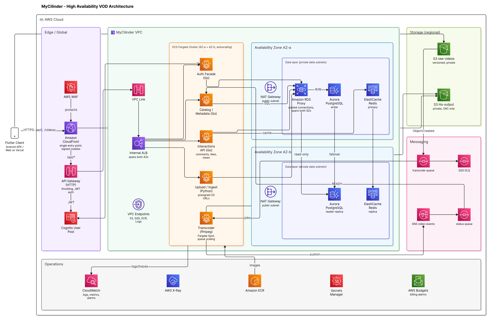
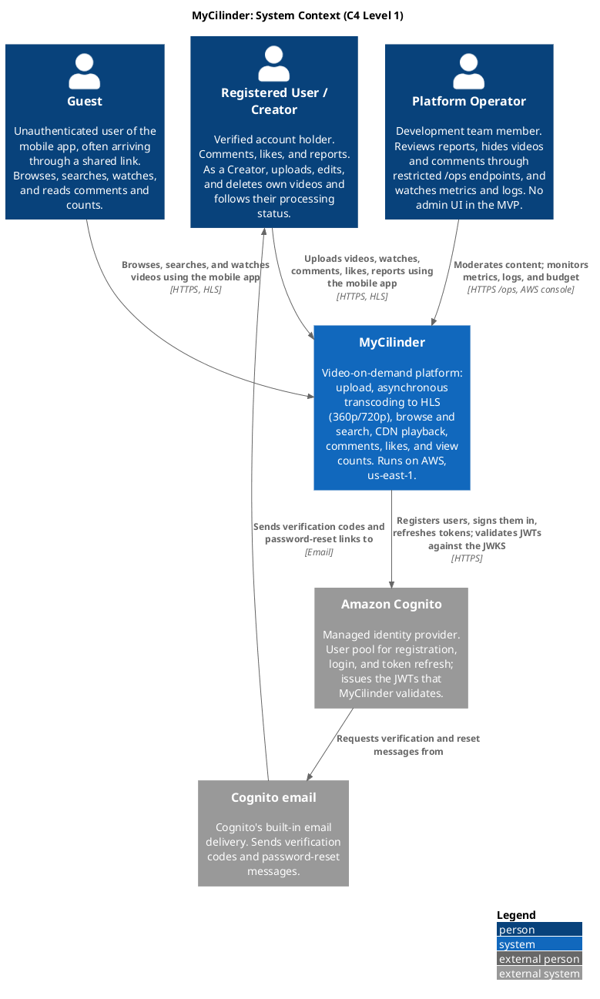
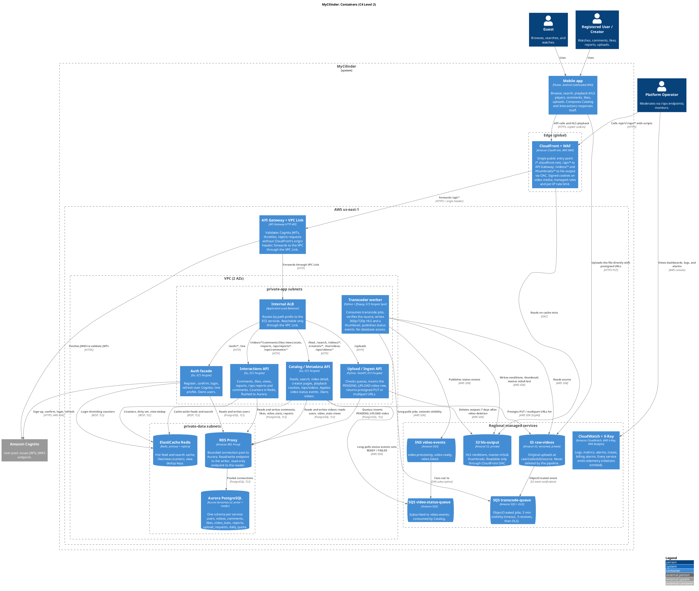
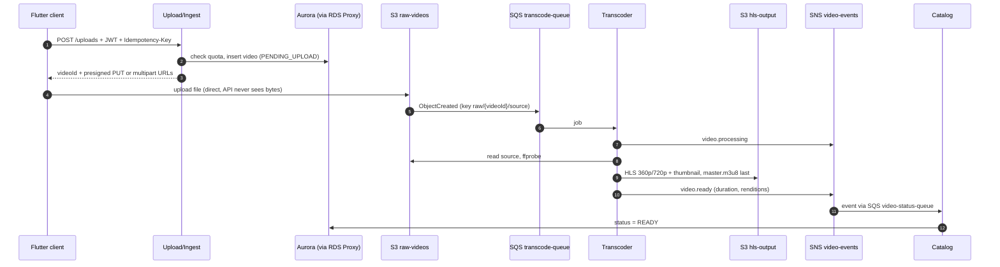
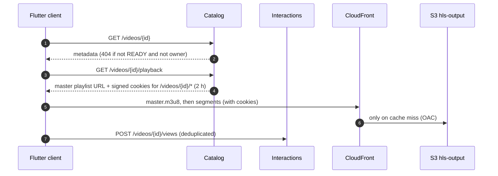
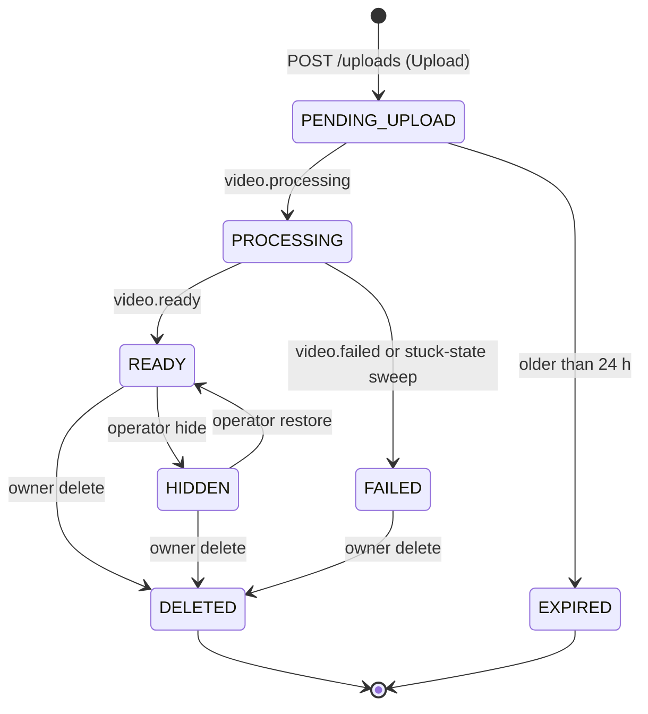

# Design Description: Architecture and Components

Part of the MyCilinder Software Design Description (SDD).
Related: [Overview](./overview.md) · [Data Design](./data-design.md) · [Interface Design](./interface-design.md) · [Requirement Specification](../requirement-specification/overall-description.md) · [Project charter](../../README.md)

---

## 1. Architectural Pattern

**Microservices on containers (ECS Fargate) with an event-driven media pipeline**, fronted by managed edge services. Five stateless services communicate synchronously through one entry point and asynchronously through SQS and SNS. The media data path never touches application compute.

| Alternative | Why not |
|-------------|---------|
| Monolith | Simpler at demo scale, but it cannot scale the queue-driven, Spot-based transcoder independently of the request-driven API, and it hides the service boundaries the course asks the team to design. |
| Serverless functions | Fits the budget, but the team chose containers for uniform Go and Python packaging (R4), and transcoding exceeds practical function limits. |
| **Microservices on Fargate** | Independent scaling signals per service, no instance management. The cost is more moving parts, contained by the contract-first approach and CI/CD. |

**Rules that follow from the pattern**
1. **Synchronous path:** client → CloudFront (WAF) → API Gateway → VPC Link → internal ALB → service. Services do not call each other synchronously, so one outage does not cascade (REL-12).
2. **Asynchronous path:** S3 `ObjectCreated` → SQS `transcode-queue` → Transcoder → SNS `video-events` → SQS `video-status-queue` → Catalog. All consumers are idempotent (REL-14).
3. **Single writer per table.** One Aurora cluster, one schema per service. A service writes only its own schema; others read it through read-only views (Data Design §1.1).
4. **Database access only through RDS Proxy.** No task connects to an Aurora endpoint directly. Fargate tasks are short-lived and their number changes with load, so the proxy holds the connection pool to Aurora and the tasks hold only small pools to the proxy (§4.3).
5. **The client composes.** Video detail (Catalog) and counts or comments (Interactions) are separate calls, so browsing and playback survive an Interactions outage.

---

## 2. System Diagrams



*Figure 1: target architecture. The demo runs a throttled subset. Request routing is in §2.1.*

The C4 diagrams below are written in PlantUML with the C4-PlantUML library that ships with PlantUML. Each `.puml` file in `docs/diagrams/` is the source; the PNG next to it is rendered from it. After editing a source, render it again with `plantuml -tpng docs/diagrams/c4-*.puml`. The diagrams cover only the Android app; a web client is not in scope for now.

**C4 Level 1: System Context** ([source](../diagrams/c4-level1-context.puml))



*Figure 2: people and external systems around MyCilinder. Actors: Guest, Registered User / Creator, Platform Operator. External systems: Amazon Cognito and Cognito email.*

**C4 Level 2: Containers** ([source](../diagrams/c4-level2-container.puml))



*Figure 3: the mobile app, edge, the five services, data stores, and messaging. The arrows to the ALB carry the routing rules in §2.1. CloudWatch and X-Ray receive telemetry from every service; those arrows are omitted.*

**C4 Level 3: Components** (one per service)

The component diagrams are a guide for the code structure, not a fixed design. Component names suggest packages (`internal/...` in Go, `app/...` or `worker/...` in Python), and shared middleware, health checks, and configuration come from `libs/` (§4.5). Adjust them as implementation progresses and keep the diagrams in sync. The detail behind each component is in §4.2.

| Service | Diagram | Source |
|---------|---------|--------|
| Auth facade | [c4-level3-auth.png](../diagrams/c4-level3-auth.png) | [c4-level3-auth.puml](../diagrams/c4-level3-auth.puml) |
| Catalog / Metadata | [c4-level3-catalog.png](../diagrams/c4-level3-catalog.png) | [c4-level3-catalog.puml](../diagrams/c4-level3-catalog.puml) |
| Interactions | [c4-level3-interactions.png](../diagrams/c4-level3-interactions.png) | [c4-level3-interactions.puml](../diagrams/c4-level3-interactions.puml) |
| Upload / Ingest | [c4-level3-upload.png](../diagrams/c4-level3-upload.png) | [c4-level3-upload.puml](../diagrams/c4-level3-upload.puml) |
| Transcoder | [c4-level3-transcoder.png](../diagrams/c4-level3-transcoder.png) | [c4-level3-transcoder.puml](../diagrams/c4-level3-transcoder.puml) |

The HTTP services share the same layering: router and middleware, then handlers, then services with the business rules, then repositories and AWS adapters. The design rules show up as components:
- **Catalog:** a single *Video lifecycle* component is the only code that changes `videos.status` (§2.3).
- **Interactions:** a *Video guard* reads `catalog.v_video_visibility` before any write.
- **Upload / Ingest:** a *Video writer* holds the `INSERT`-only grant on `catalog.videos`.
- **Transcoder:** no component talks to the database.

### 2.1 Request routing

A single CloudFront distribution on its default `*.cloudfront.net` domain is the only public entry point. WAF is attached to it.

| CloudFront path | Origin |
|-----------------|--------|
| `/api/*` | API Gateway HTTP API, then VPC Link to the internal ALB |
| `/videos/*`, `/thumbnails/*` | S3 `hls-output` through OAC (Data Design §3.1) |

The ALB routes by path. Paths keep the `/api/v1` prefix end to end; it is omitted below. The endpoint list is in the Interface Design §1.2.

| ALB rule (priority order) | Service |
|---------------------------|---------|
| `/auth/*`, `/me` | Auth facade |
| `/uploads`, `/uploads/*` | Upload / Ingest |
| `/videos/*/stats`, `/videos/*/comments`, `/videos/*/like`, `/videos/*/views`, `/reports`, `/ops/reports*`, `/ops/comments/*` | Interactions |
| `/feed`, `/search`, `/creators/*`, `/videos/*`, `/me/videos`, `/ops/videos/*` | Catalog |

### 2.2 Key flows

**Upload to ready** (FR-UP, FR-TR)



**Watch** (FR-PB)



API calls to Catalog and Interactions also pass through CloudFront, API Gateway, the VPC Link, and the ALB (omitted for readability).

### 2.3 Video state ownership

Each lifecycle transition (Functional Requirements §1.0) has exactly one actor. Catalog accepts a transition only if it moves forward, so duplicate or out-of-order events are ignored.



| Transition | Actor | Trigger |
|------------|-------|---------|
| (none) → `PENDING_UPLOAD` | Upload / Ingest | `POST /uploads` accepted. The only write Upload makes to `videos`. |
| `PENDING_UPLOAD` → `PROCESSING` | Catalog | `video.processing` event. `UPLOADED` is transient and not stored (FR-UP-06). |
| `PROCESSING` → `READY` / `FAILED` | Catalog | `video.ready` / `video.failed` event |
| `PROCESSING` → `FAILED` | Catalog job | Still `PROCESSING` after 2 hours (F5) |
| `PENDING_UPLOAD` → `EXPIRED` | Catalog job | Older than 24 hours (FR-UP-08) |
| `READY` ↔ `HIDDEN` | Catalog | Operator call on `/ops/videos/*` |
| `READY`, `HIDDEN`, `FAILED` → `DELETED` | Catalog | Owner call (soft delete, BR-05) |

---

## 3. Technology Stack

Platform choices are in README §6.3. Region `us-east-1` and ffmpeg on Fargate Spot are settled in the [Overview](./overview.md) §2.5. The libraries per language are:

| Purpose | Go services (Auth, Catalog, Interactions) | Python services (Upload / Ingest, Transcoder) |
|---------|-------------------------------------------|-----------------------------------------------|
| HTTP server and routing | `net/http` with `go-chi/chi` | FastAPI on `uvicorn` (Upload only; the Transcoder has no HTTP API) |
| PostgreSQL (through RDS Proxy) | `jackc/pgx` (with `pgxpool`), query mode `QueryExecModeExec` so no named prepared statements are created | `psycopg` 3 with `psycopg_pool`, `prepare_threshold=None` (Upload only) |
| Redis | `redis/go-redis` | not used |
| AWS | AWS SDK for Go v2 | `boto3` |
| JWT validation (Cognito JWKS) | `lestrrat-go/jwx` | `PyJWT` with its JWKS client |
| Logging | `log/slog` with the JSON handler | `structlog` with JSON output |
| Tracing | OpenTelemetry Go SDK with `otelhttp`, exported to X-Ray through the collector sidecar | OpenTelemetry Python SDK with FastAPI and botocore instrumentation, same exporter |
| Retries and circuit breaker | `cenkalti/backoff` and `sony/gobreaker` | `tenacity` and `pybreaker` |
| Schema migrations | `golang-migrate` (plain SQL files, also used for the `upload` schema) | `golang-migrate` |
| Lint and format (MAINT-10) | `gofmt`, `golangci-lint` | `ruff`, `black`, `mypy` |
| Tests | `go test` | `pytest` |
| Media | not used | `ffmpeg` / `ffprobe` as subprocesses, bundled in the worker image |

API contracts are validated against `openapi.yaml` in CI (MAINT-01).

**Driver settings for RDS Proxy.** The proxy reuses an Aurora connection for another client at the end of each transaction, unless the session holds state that would leak to that client. In that case it *pins* the client to one Aurora connection, which defeats pooling. For PostgreSQL, pinning is caused by session `SET` commands, named prepared statements, session-level advisory locks, temporary tables, `LISTEN`, and cursors declared outside a transaction. The rules that follow:
- Drivers do not create named prepared statements (settings above). Queries remain parameterized (SEC-07).
- Session settings (`search_path`, `statement_timeout`, `TimeZone`) are set per PostgreSQL role with `ALTER ROLE … SET`, or in the proxy's initialization query. Code uses `SET LOCAL` inside a transaction when it needs a different value.
- Locks for background jobs are transaction-level (`pg_try_advisory_xact_lock`, §4.2).
- Pools do not run `DISCARD ALL` as a reset query.
- The CloudWatch metric `DatabaseConnectionsCurrentlySessionPinned` has an alarm, so a change that introduces pinning is visible.

---

## 4. Module Breakdown

### 4.1 Services

Responsibilities per service are in README §3.2 and the FR areas below. This table adds data ownership.

| Service | Lang | Owns | FR area | Reads (read-only views) |
|---------|------|------|---------|-------------------------|
| **Auth facade** | Go | `users` (profile keyed by Cognito `sub`) | FR-AUTH | none |
| **Catalog / Metadata** | Go | `videos`, except the initial insert | FR-PB (except views), FR-BR, FR-CR, FR-MOD-04 (videos) | `users`, `video_stats` |
| **Interactions** | Go | `comments`, `likes`, `video_stats`, `reports` | FR-IN, FR-PB-04, FR-MOD-01..03, FR-MOD-04 (comments) | `videos` (existence, visibility) |
| **Upload / Ingest** | Python | `upload_requests`, `daily_quota`; inserts the initial `videos` row | FR-UP | none |
| **Transcoder** | Python + ffmpeg | nothing; no database access | FR-TR | S3, SQS |

### 4.2 Design detail per service

**Auth facade.** Public routes (register, confirm, login, refresh) bypass the API Gateway JWT authorizer and are throttled (SEC-09). The profile row is created on first login (FR-AUTH-05). Cognito details are in the Interface Design §3.1.

**Catalog.**
- *Feeds and search:* cache-aside in Redis (TTLs in Data Design §3.2) with single-flight against stampedes; falls back to the Aurora reader when Redis is down.
- *Playback access:* checks visibility (`HIDDEN`, `DELETED`, unknown return 404 to non-owners), then returns signed cookies scoped to `/videos/{videoId}/*`, valid 2 hours (Interface Design §1.3). The signing key is in Secrets Manager.
- *Status consumer:* long-polls `video-status-queue` and applies the forward-only state machine (§2.3).
- *Background jobs:* pending-upload expiry (every 15 minutes), the stuck-state sweep (every 15 minutes), and removal of HLS outputs 7 days after deletion (daily).

**Interactions.**
- *Likes:* the `likes` row is the source of truth; `INSERT … ON CONFLICT DO NOTHING` on `(video, user)` makes it idempotent, and the Redis counter changes only if a row was inserted or deleted.
- *Views:* Redis `SET NX EX 1800` on `(video, viewer)` implements BR-VIEW; guests use the `X-Session-Id` value.
- *Counters:* increments go to Redis plus a dirty set. Background jobs flush deltas into `video_stats` every 5 seconds and reconcile like and comment counts from source rows every hour (BR-07, Data Design §3.2).
- *Moderation:* stores reports, serves the operator queue, and hides reported comments.

**Upload / Ingest.**
- Files up to 100 MB get one presigned PUT that signs `Content-Type` and `Content-Length` for the key `raw/{videoId}/source`. Larger files use multipart with one presigned URL per 64 MB part. All URLs expire in 15 minutes, and the declared size is checked against the 1 GB cap. A bucket lifecycle rule aborts incomplete multipart uploads after 1 day.
- The declared metadata is not trusted: the worker re-verifies the real file (FR-UP-07, SEC-08).

**Transcoder.**
- *Polling:* derives `videoId` from the object key. The queue's visibility timeout is 5 minutes, and the worker extends it every minute while working, so a crashed worker's message reappears within 5 minutes.
- *Idempotency:* the master playlist is written **last** and acts as the commit marker. If it already exists, the worker re-publishes `video.ready` and deletes the message.
- *Events:* `video.processing`, `video.ready`, `video.failed` (Interface Design §2.1). On the last allowed receive (the 3rd, FR-TR-06) a handled failure emits `video.failed` before the message reaches the DLQ.
- *Spot:* on `SIGTERM` the worker stops and leaves the message untouched so it becomes visible again; the task `stopTimeout` is set to the maximum (120 seconds).
- *Isolation:* ffmpeg runs as a non-root user with a read-only root filesystem and no database credentials.

**Background jobs (F7).** Periodic work runs as loops inside the owning service. Every task runs the loop, but each run opens a transaction and first takes a transaction-level PostgreSQL advisory lock (`pg_try_advisory_xact_lock`). Only one task does the work at a time, and no scheduler component is needed. The lock is released at commit or rollback, so it does not pin the connection in RDS Proxy (§3), and a task that dies mid-run releases it when the proxy closes its transaction. Each run processes a bounded batch so the transaction stays short.

### 4.3 Sizing

| Service | Task size | Design | Demo |
|---------|-----------|--------|------|
| Auth, Catalog, Interactions | ≤ 0.5 vCPU / 1 GB (PERF-09) | ≥ 2 each; about 10 API tasks at 1M DAU (NFR §5.7) | 1 each |
| Upload / Ingest | 0.5 vCPU / 1 GB | 2 to 4 | 1 |
| Transcoder | 2 vCPU / 4 GB; 30 GB ephemeral storage for a 1 GB source plus output | 0 to about 105 at 1M DAU peak (NFR §5.5); scales on queue backlog per task, with an alarm-based step from 0 to 1 | 0 to 2 |

**Database connections.** Every database-using task keeps a small pool to RDS Proxy: at most 10 connections for the Go services and 5 for Upload / Ingest, released at the end of each transaction. The number of client connections grows with the number of tasks, and doubles briefly during a rolling deployment while old and new tasks overlap. The number of Aurora connections does not: the proxy's `MaxConnectionsPercent` caps it at a fixed share of Aurora's `max_connections`, leaving the rest for migrations and operator sessions. When every pooled connection is busy, the proxy queues new transactions up to its borrow timeout (set to 5 seconds) and then returns an error, which the service maps to `503` (Interface Design §1.1). The Transcoder has no database access and never counts against the pool.

### 4.4 Security boundaries (SEC-06)

| Service | Task role allows |
|---------|------------------|
| Auth facade | Its secrets. The Cognito operations it uses are authorized by the app client secret and user tokens, not IAM. |
| Catalog | Receive and delete on `video-status-queue`; `ListBucket` and `DeleteObject` on `hls-output` (cleanup); its secrets, including the CloudFront signing key |
| Interactions | Its secrets |
| Upload / Ingest | `PutObject` and multipart actions on `raw-videos`; its secrets |
| Transcoder | `GetObject` on `raw-videos`; `PutObject` on `hls-output`; receive, delete, and change visibility on `transcode-queue`; publish to `video-events`. No database. |

All tasks may also write traces to X-Ray through the collector sidecar. Each service uses its own PostgreSQL role with grants only on its own schema plus the read-only views (Data Design §1.1). The role's credentials are a Secrets Manager secret that both the service and RDS Proxy can read; the proxy has its own IAM role limited to those secrets, and it requires TLS from clients. Security groups chain VPC Link → ALB → services → RDS Proxy → Aurora, and services → Redis, with no other ingress. Aurora accepts connections only from the proxy's security group.

### 4.5 Repository layout

This repository is a monorepo for all backend services. Each service builds its own image and deploys independently (MAINT-09).

```
MyCilinder-Backend/
├── services/
│   ├── auth/            # Go
│   ├── catalog/         # Go
│   ├── interactions/    # Go
│   ├── upload/          # Python
│   └── transcoder/      # Python + ffmpeg
├── libs/
│   ├── go/              # shared Go module
│   └── python/          # shared Python package
├── migrations/          # one folder per schema: auth, catalog, interactions, upload, audit
├── deploy/local/        # Docker Compose for local development
└── docs/
```

Each service folder contains its code, `Dockerfile`, tests, and README (MAINT-07). The shared libraries cover JWT validation, origin-header verification, structured logging with a correlation id, configuration from environment variables, retries with backoff, the circuit breaker, per-user rate limiting, and `/healthz` and `/readyz`.

---

## 5. Design Review Findings

Issues found while turning the baseline into a design. All resolutions were accepted by the team and are reflected in the documents.

| # | Finding | Resolution |
|---|---------|------------|
| F1 | **WAF cannot be attached to an API Gateway *HTTP* API.** AWS WAF supports REST APIs, CloudFront, ALB, and others, but not HTTP APIs. | The API is served through the same CloudFront distribution as media (`/api/*`), and WAF is attached to the distribution. CloudFront adds a secret origin header that the services verify, so API Gateway's own endpoint cannot bypass WAF (Interface Design §3.2). |
| F2 | **HLS authorization.** A signed URL for the master playlist does not authorize the segment URLs inside it. | CloudFront signed cookies scoped to `/videos/{videoId}/*`, on the same domain as the API (F1). The Android player passes them as a header (Interface Design §1.3). Validated in the walking skeleton (R5). |
| F3 | **Per-user and per-IP rate limits (SEC-09).** An HTTP API throttles per route or stage, not per client. | Per IP: a WAF rate-based rule. Per user: a Redis counter in the shared library. API Gateway stage throttling remains as a global ceiling. |
| F4 | **State ownership gaps.** (a) Nothing marks `UPLOADED`. (b) Two services wrote `videos`. (c) Reports, moderation, and profiles had no owning service. | (a) `UPLOADED` is transient (FR-UP-06). (b) Upload only inserts; Catalog owns every later change, enforced with PostgreSQL grants. (c) Auth owns profiles, Interactions owns reports and comment hiding, Catalog owns video hide and restore. |
| F5 | **Jobs that crash never produce `FAILED`.** A message that reaches the DLQ after hard crashes or repeated Spot interruptions emits no event. | The worker emits `video.failed` on handled errors at the last attempt; Catalog's sweep marks videos still `PROCESSING` after 2 hours as `FAILED`; a DLQ alarm lets an operator re-drive the message. |
| F6 | **Fixed hourly costs dominate the credits.** Always-on: NAT Gateways, ALB, Aurora, RDS Proxy (billed for at least 8 ACUs with Aurora Serverless v2, whatever capacity Aurora uses), Redis nodes, interface VPC endpoints, WAF, idle Fargate tasks. SNS, Cognito, Secrets Manager, and X-Ray traffic goes through NAT. | Demo: one NAT, single-node Redis, Aurora writer only, minimum tasks 1, and destroy or scale to zero the expensive layers between sessions. Costs are estimated with the AWS Pricing Calculator before the Deployment gate. |
| F7 | **No scheduler** for periodic work (expiry, stuck-state sweep, output cleanup, counter flush, reconciliation). | In-service loops under a transaction-level PostgreSQL advisory lock (§4.2), which is compatible with RDS Proxy. No new component. |
