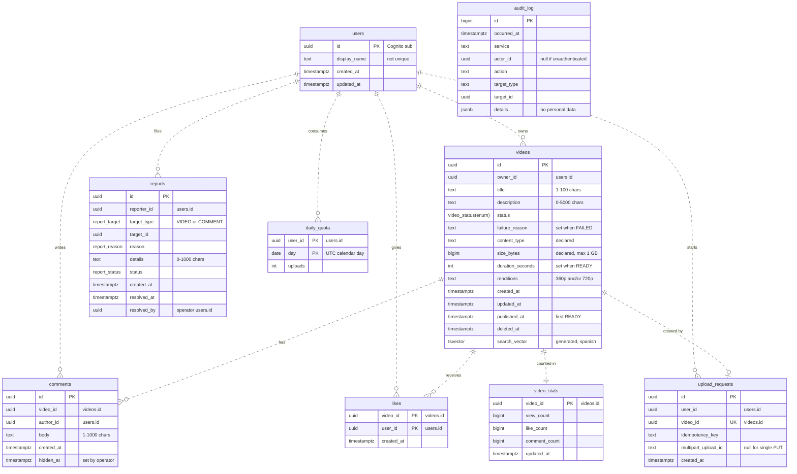
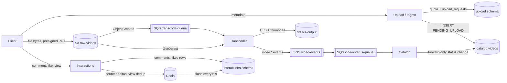
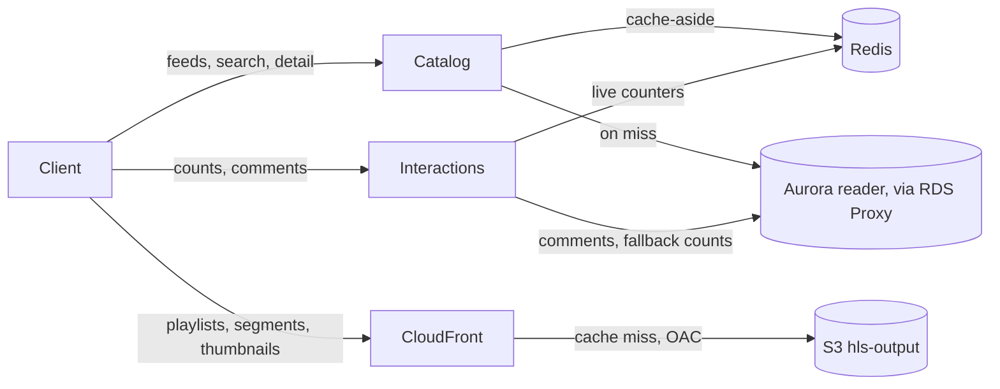

# Design Description: Data Design

Part of the MyCilinder Software Design Description (SDD).
Related: [Overview](./overview.md) · [Architecture and Components](./architecture-and-components.md) · [Interface Design](./interface-design.md) · [Functional Requirements](../requirement-specification/functional-requirements.md) · [Non-Functional Requirements](../requirement-specification/non-functional-requirements.md)

**Conventions**
- Service data ownership is defined in Architecture §4.1. This document defines what each service stores and how data moves between stores.
- Limits (lengths, sizes, quotas) come from BR-LIM in the Functional Requirements and are enforced both in the service and, where possible, as database constraints.
- Volumes are in NFR §5.4: about 200 GB of relational data per year at 1M DAU, so a single Aurora cluster with no sharding is enough for year one.

---

## 1. Data Models and Schemas

### 1.1 Database layout

One Aurora PostgreSQL Serverless v2 cluster holds one database with **one schema per service**. A service writes only to its own schema and reads other services' data only through read-only views. Each service connects with its own PostgreSQL role (Architecture §4.4), always through Amazon RDS Proxy and never to an Aurora endpoint directly (Architecture §1, rule 4).

| Schema | Owner (writer) | Tables | Views exposed to other services |
|--------|----------------|--------|--------------------------------|
| `auth` | Auth facade | `users` | `auth.v_user_public` (id, display name) to Catalog and Interactions |
| `catalog` | Catalog | `videos` | `catalog.v_video_visibility` (id, owner, status) to Interactions |
| `interactions` | Interactions | `comments`, `likes`, `video_stats`, `reports` | `interactions.v_video_stats` to Catalog |
| `upload` | Upload / Ingest | `upload_requests`, `daily_quota` | none |
| `audit` | shared, append-only | `audit_log` | none (operators query it directly) |

Two deliberate exceptions to "one writer per table":
- **`catalog.videos`:** Upload / Ingest holds `INSERT` only, to create the row in `PENDING_UPLOAD`. Every later change belongs to Catalog (Architecture §2.3).
- **`audit.audit_log`:** Auth, Catalog, and Interactions hold `INSERT` only. No role has `UPDATE` or `DELETE`, so the trail cannot be altered by a service (SEC-15).

References between schemas are **logical** (no foreign key constraints), so each service can migrate its schema independently (MAINT-09). Each service ships plain-SQL migrations for its own schema, and migrations stay backward compatible with the previous release (REL-17).

### 1.2 Entity-relationship diagram

Dotted lines are logical references across schemas.

### 1.3 Tables

All identifiers are UUIDs (they appear in permalinks such as `/watch/{videoId}`), except `audit_log.id`, which is internal. Timestamps are `timestamptz` in UTC.

**`auth.users`.** The profile created on first login (FR-AUTH-05). `id` is the Cognito `sub`. Email and password stay in Cognito only, so the local profile holds no personal data beyond the display name (SEC-12). Display names are not unique.

**`catalog.videos`.** The video record and its lifecycle.
- `status` is the enum `video_status`: `PENDING_UPLOAD`, `PROCESSING`, `READY`, `FAILED`, `HIDDEN`, `DELETED`, `EXPIRED`. `UPLOADED` is transient and never stored (Functional Requirements §1.0).
- The raw object key is derived as `raw/{id}/source`, the HLS master as `videos/{id}/master.m3u8`, and the thumbnail as `thumbnails/{id}.jpg`. No keys are stored.
- `search_vector` is a stored generated column: `setweight(to_tsvector('spanish', title), 'A') || setweight(to_tsvector('spanish', description), 'B')`. Titles rank above descriptions.
- Indexes:
  - `GIN (search_vector)` for search (FR-BR-03);
  - partial `(published_at DESC, id) WHERE status = 'READY'` for the recent feed (FR-BR-01);
  - `(owner_id, created_at DESC, id)` for the creator studio and creator pages (FR-CR-01, FR-BR-07);
  - partial `(status, updated_at) WHERE status IN ('PENDING_UPLOAD', 'PROCESSING', 'DELETED')` for background jobs.

**`upload.upload_requests`.** One row per upload, holding the client's `Idempotency-Key` (REL-15) and, for multipart uploads, the S3 `UploadId`. `UNIQUE (user_id, idempotency_key)`: a retried request returns the existing `videoId` and does not consume quota.

**`upload.daily_quota`.** Upload count per user per **UTC calendar day** (BR-LIM: 5). The check and the increment are one atomic statement, so concurrent requests cannot exceed the limit:
`INSERT … ON CONFLICT (user_id, day) DO UPDATE SET uploads = daily_quota.uploads + 1 WHERE daily_quota.uploads < 5 RETURNING uploads`. No row returned means the quota is exhausted.

**`interactions.comments`.** Flat comments (A-08). Users cannot edit or delete comments in the MVP. An operator hides a reported comment by setting `hidden_at`; hidden comments are excluded from lists and counts. Index: partial `(video_id, created_at DESC, id) WHERE hidden_at IS NULL` (FR-IN-02).

**`interactions.likes`.** Source of truth for likes. The primary key `(video_id, user_id)` enforces BR-04, and `INSERT … ON CONFLICT DO NOTHING` makes liking idempotent (FR-IN-05).

**`interactions.video_stats`.** Durable counters, one row per video, updated in batches from Redis (§3.2). Index `(view_count DESC, video_id)` for the most-viewed feed (FR-BR-02).

**`interactions.reports`.**
- Enum `report_reason`: `SPAM`, `HARASSMENT`, `SEXUAL_CONTENT`, `VIOLENCE`, `COPYRIGHT`, `OTHER`.
- Enum `report_status`: `OPEN`, `RESOLVED`, `DISMISSED`.
- Partial unique index `(reporter_id, target_type, target_id) WHERE status = 'OPEN'` enforces FR-MOD-02.
- Index `(status, created_at)` for the operator queue (FR-MOD-03).

**`audit.audit_log`.** Append-only trail for SEC-15.

| Writer | Actions recorded |
|--------|------------------|
| Auth facade | `auth.register`, `auth.login_succeeded`, `auth.login_failed`, `auth.logout` |
| Catalog | `video.hidden`, `video.restored` |
| Interactions | `comment.hidden`, `report.resolved`, `report.dismissed` |

`details` never contains tokens, passwords, or emails (SEC-12); a failed login stores no actor. The same events are also written to the structured logs (MAINT-05).

---

## 2. Data Flow

Data is validated in layers, from the cheapest check at the edge to the database constraints that are the last line of defense.

| Layer | Validates |
|-------|-----------|
| CloudFront + WAF | Managed rules, per-IP rate limit (SEC-09) |
| API Gateway | JWT signature and expiry on protected routes, stage throttling |
| Service | JWT re-check (SEC-01), ownership (SEC-02), types, lengths, and limits from BR-LIM (SEC-07), per-user rate limit in Redis |
| PostgreSQL | `CHECK` lengths, enums, unique keys, parameterized queries only |
| Transcoder | The real file: container, codec, duration, resolution via `ffprobe` (FR-UP-07, SEC-08) |

### 2.1 Write paths

- **Upload:** the API never handles the bytes (C-08). Upload / Ingest writes `upload_requests`, the quota row, and the `videos` row in one transaction.
- **Processing:** Catalog applies each event only if it moves the status forward, so redelivered or out-of-order events are ignored (Architecture §2.3). The Transcoder has no database access.
- **Comments:** the row is inserted in Aurora, then the comment counter is incremented in Redis.
- **Likes:** the row is inserted or deleted in Aurora; the Redis counter changes only when a row actually changed.
- **Views:** deduplicated in Redis (BR-VIEW) and counted only in Redis until the next flush. There are no view rows.
- **Moderation:** Catalog (videos) and Interactions (comments, reports) change the target and insert the `audit_log` row in the same transaction.

### 2.2 Read paths

- Reads go to the RDS Proxy read-only endpoint, which targets the Aurora reader. Writes and read-after-write checks (ownership, idempotency) go to the proxy's default read/write endpoint, which targets the writer. If the reader is unavailable, services send reads to the read/write endpoint. Each service has the two endpoints as configuration variables.
- Lists use keyset pagination: the opaque cursor encodes the last row's sort key and `id`, so pages stay stable while new videos arrive and no query uses `OFFSET` (SCAL-06).
- Feeds and search show the `view_count` from `video_stats`, which can lag by the flush interval plus the feed cache TTL (about 35 s). The video page reads live counters from Redis through Interactions (A-10).

### 2.3 Deletion and retention

| Data | On delete or hide | Retention |
|------|-------------------|-----------|
| Video record | `DELETED` or `HIDDEN` status (soft delete, BR-05) | Kept |
| Raw upload | Never deleted by the system (BR-05) | Moves to Glacier after 30 days (§3.3) |
| HLS output and thumbnail | Deleted by Catalog 7 days after the video becomes `DELETED`. Kept while `HIDDEN`, so a restore needs no reprocessing. | Until deleted |
| Expired pending upload | Status `EXPIRED`; no object exists | Kept |
| Comments | Hidden by an operator (`hidden_at`) | Kept |
| Likes, stats, reports, audit log | Not deleted in the MVP | Kept |

---

## 3. Caching and Storage Strategy

### 3.1 CloudFront

One distribution serves both API and media (Architecture §2.1).

| Path | Origin | Cache policy | Access |
|------|--------|--------------|--------|
| `/api/*` | API Gateway | Managed `CachingDisabled` | Public routes or JWT |
| `/videos/*` | S3 `hls-output` through OAC | Managed `CachingOptimized`. Playlists and segments never change once written, so they are cached as long as the policy allows. | Signed cookies (trusted key group) |
| `/thumbnails/*` | S3 `hls-output` through OAC | Managed `CachingOptimized` | Unsigned |

Signed cookies stay out of the cache key, so all viewers of a video share the same cached segments. This is what keeps the cache hit ratio near the 90% target (PERF-05).

Thumbnails are unsigned because a feed page shows up to 50 different videos, and per-video cookies cannot cover them without signing every image URL. A thumbnail is a still image of a public video, and the stream itself remains protected (BR-06).

### 3.2 Redis

ElastiCache Redis holds two kinds of keys with different durability needs. The eviction policy is `volatile-lru`: only keys with a TTL can be evicted, so counter deltas are never lost to memory pressure.

| Key | Owner | Content | TTL | Invalidation |
|-----|-------|---------|-----|--------------|
| `feed:{sort}:{cursor}:{limit}` | Catalog | Page of video cards | 30 s | Expiry only |
| `search:{hash(query)}:{cursor}:{limit}` | Catalog | Page of results | 30 s | Expiry only |
| `video:{id}` | Catalog | Video detail (metadata, no counts) | 60 s | Deleted on every Catalog write to the video |
| `stats:{id}` | Interactions | Current views, likes, comments | 1 h, renewed on write | Rebuilt from `video_stats` on a miss and after reconciliation |
| `stats:delta:{id}` | Interactions | Increments not yet flushed | None | Cleared by the flusher |
| `stats:dirty` | Interactions | Set of video ids with pending deltas | None | Cleared by the flusher |
| `view:{videoId}:{viewerId}` | Interactions | View deduplication marker (BR-VIEW) | 30 min | Expiry only |
| `rl:{userId}:{class}:{minute}` | All API services | Per-user request count (SEC-09) | 60 s | Expiry only |

- **Stampede protection:** Catalog collapses concurrent misses for the same key into one database query per task.
- **Counter flush:** every 5 seconds the flusher takes up to a batch of ids from `stats:dirty`, reads and resets their deltas atomically (Lua script), and applies them with one batched `UPDATE` to `video_stats`. It runs under a transaction-level PostgreSQL advisory lock, so only one task flushes at a time (Architecture §4.2).
- **Reconciliation:** every hour, like and comment counts are recomputed from `likes` and visible `comments` rows and written to `video_stats` (BR-07). Views have no source rows; a lost flush loses at most 5 seconds of views.
- **Redis unavailable:** Catalog reads from Aurora. Interactions serves counts from `video_stats`, keeps deltas in a bounded in-memory buffer that it flushes directly to Aurora, counts views without deduplication, and skips the per-user rate limit (the WAF per-IP limit still applies). REL-12 describes the expected behavior.

### 3.3 Object storage

| Bucket | Keys | Settings | Lifecycle |
|--------|------|----------|-----------|
| `raw-videos` | `raw/{videoId}/source` | Private, Block Public Access, versioned, SSE-S3 | Abort incomplete multipart uploads after 1 day (FR-UP-08). Move current and noncurrent versions to **S3 Glacier Flexible Retrieval** after **30 days**. Never expire (BR-05). |
| `hls-output` | `videos/{videoId}/master.m3u8`, `videos/{videoId}/{360p,720p}/…`, `thumbnails/{videoId}.jpg` | Private, Block Public Access, SSE-S3, readable only by CloudFront OAC | Outputs of `DELETED` videos are removed by Catalog after **7 days** (§2.3). A lifecycle rule cannot do this, because it cannot see the video status. |

- Glacier Flexible Retrieval objects need a restore of minutes to hours before they can be read. This is acceptable because raw files are read only for reprocessing (R9 contingency).
- Raw media is the largest share of storage (300 MB raw against 124 MB of HLS per video, NFR §5.4), so the Glacier transition gives the biggest saving at scale.

### 3.4 Relational data durability

Aurora keeps continuous backups with point-in-time recovery. The design target is RPO ≤ 5 minutes with a reader replica in a second AZ; the demo runs the writer only and accepts RPO ≤ 24 hours (REL-04, Overview §2.4). The backup retention period is a Terraform variable, and a restore is tested before the Deployment gate (REL-16).
