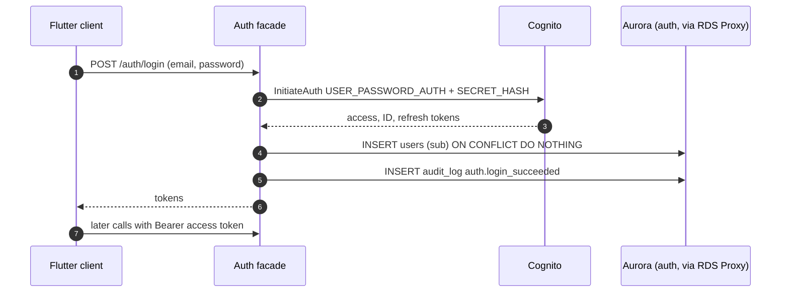

# Design Description: Interface Design

Part of the MyCilinder Software Design Description (SDD).
Related: [Overview](./overview.md) · [Architecture and Components](./architecture-and-components.md) · [Data Design](./data-design.md) · [`openapi.yaml`](../openapi.yaml) · [Functional Requirements](../requirement-specification/functional-requirements.md)

**Conventions**
- This document defines the API conventions, the endpoint catalog, the internal message contracts, and the external integrations. Field-level request and response schemas live in [`openapi.yaml`](../openapi.yaml) (§4).
- Request routing from the edge to each service is in Architecture §2.1; the stored data behind each endpoint is in the Data Design.

---

## 1. External API

### 1.1 Conventions

| Aspect | Rule |
|--------|------|
| Style | REST over HTTPS (TLS 1.2+, SEC-03), JSON bodies, `camelCase` fields. |
| Base URL | `https://{distribution}.cloudfront.net/api/v1`. The deployment uses the default CloudFront domain (Overview §2.5, P8). |
| Versioning | Major version in the path (`/v1`). Breaking changes after the Design freeze need a change request and a new version (C-06, MAINT-09). Adding optional fields is not breaking. |
| Authentication | `Authorization: Bearer <access token>` with a Cognito access token. API Gateway validates it on protected routes, and the service validates it again (SEC-01). On optional-auth routes (marked "Optional" below) API Gateway lets the request through and the service validates the token only if present. |
| Operators | Operator routes require `operators` in the token's `cognito:groups` claim. The service checks it. |
| Identifiers and time | UUIDs for all resources. Timestamps in RFC 3339, UTC. |
| Pagination | `?cursor=<opaque>&limit=<n>` (default 20, maximum 50, BR-LIM). Responses are `{ "items": [...], "nextCursor": "..." }`; `nextCursor` is `null` on the last page. |
| Idempotency | `POST /uploads` requires an `Idempotency-Key` header (REL-15). Repeating the key returns the original result. Likes (`PUT` / `DELETE`) and views are idempotent by design. |
| Guest sessions | Guests send `X-Session-Id: <UUID>` with view events. The client generates the UUID once and stores it locally. It is used only for view deduplication (BR-VIEW). |
| Correlation | Clients may send `X-Correlation-Id`; the edge service generates one if absent. It is returned in the response and propagated in logs and traces (MAINT-05). |
| Rate limits | Per IP in WAF, per user in the service (SEC-09). Rejections return `429` with `Retry-After`. |
| CORS | Allowed origins are the Vercel web domain and local development. Credentials are allowed, because the playback endpoint sets cookies (SEC-13). |

**Errors.** Every error response uses RFC 9457 Problem Details (`Content-Type: application/problem+json`):

```json
{
  "type": "/problems/validation-error",
  "title": "Request validation failed",
  "status": 400,
  "detail": "title must be 1-100 characters",
  "instance": "/api/v1/uploads",
  "correlationId": "4f1c...",
  "errors": [{ "field": "title", "rule": "length" }]
}
```

| Status | `type` | Used when |
|--------|--------|-----------|
| 400 | `/problems/validation-error` | Malformed body, wrong type or length (`errors` lists each field) |
| 401 | `/problems/unauthenticated` | Missing, expired, or invalid token; invalid credentials |
| 403 | `/problems/forbidden` | Not the owner, not an operator, or account not confirmed |
| 404 | `/problems/not-found` | Unknown resource, or a video that is not `READY` for a non-owner (FR-PB-06) |
| 409 | `/problems/conflict` | Duplicate open report (FR-MOD-02), idempotency key reused with a different body, invalid status transition |
| 422 | `/problems/limit-exceeded` | A BR-LIM rule: format, size, duration declared too large (`detail` names the rule) |
| 429 | `/problems/rate-limited`, `/problems/quota-exceeded` | Rate limit or daily upload quota |
| 503 | `/problems/unavailable` | A required dependency is down (circuit open) |

### 1.2 Endpoint catalog

Paths are relative to `/api/v1`. Auth: **Public** (no token), **Optional** (token used if sent), **JWT**, **Owner** (JWT plus ownership), **Operator**.

**Auth facade**

| Method and path | Auth | Purpose | Success | FR |
|-----------------|------|---------|---------|----|
| `POST /auth/register` | Public | Email, password, display name. Starts Cognito sign-up. | 202 | FR-AUTH-01 |
| `POST /auth/confirm` | Public | Email and verification code. | 204 | FR-AUTH-02 |
| `POST /auth/resend-code` | Public | Sends a new verification code (UC-01 5a). | 204 | FR-AUTH-02 |
| `POST /auth/login` | Public | Returns `accessToken`, `idToken`, `refreshToken`, `expiresIn`. Creates the profile on first login. | 200 | FR-AUTH-03, 05 |
| `POST /auth/refresh` | Public | Exchanges a refresh token for new access and ID tokens. | 200 | FR-AUTH-04 |
| `POST /auth/logout` | JWT | Revokes the refresh token. | 204 | FR-AUTH-06 |
| `GET /me` | JWT | Own profile: id, email (read from Cognito), display name. | 200 | FR-AUTH-08 |
| `PATCH /me` | JWT | Change display name. | 200 | FR-AUTH-08 |

**Upload / Ingest**

| Method and path | Auth | Purpose | Success | FR |
|-----------------|------|---------|---------|----|
| `POST /uploads` | JWT | Title, description, file name, content type, size. Checks limits and quota, creates the video, returns upload instructions. | 201 | FR-UP-01–03, 05 |
| `POST /uploads/{videoId}/urls` | Owner | Fresh upload URL(s) for a video still in `PENDING_UPLOAD` (UC-03 4a, 4b). | 200 | FR-UP-09 |
| `POST /uploads/{videoId}/complete` | Owner | Multipart only: part numbers and ETags. The service completes the S3 multipart upload. | 204 | FR-UP-05 |

The `POST /uploads` response is either a single upload or a multipart upload. Files above 100 MB use multipart, following the AWS guidance for S3 multipart uploads.

```json
{
  "videoId": "8d0c...",
  "method": "MULTIPART",
  "partSizeBytes": 67108864,
  "parts": [{ "partNumber": 1, "url": "https://raw-videos.s3..." }],
  "expiresAt": "2026-11-01T02:15:00Z"
}
```

For `"method": "PUT"`, the response has a single `uploadUrl` instead of `parts`, and the client must send exactly the declared `Content-Type` and `Content-Length`.

**Catalog**

| Method and path | Auth | Purpose | Success | FR |
|-----------------|------|---------|---------|----|
| `GET /feed?sort=recent\|most_viewed` | Public | Paginated video cards. | 200 | FR-BR-01, 02, 04–06 |
| `GET /search?q=` | Public | Spanish full-text search over title and description, ranked. | 200 | FR-BR-03 |
| `GET /creators/{userId}/videos` | Public | A creator's `READY` videos. | 200 | FR-BR-07 |
| `GET /videos/{videoId}` | Optional | Video detail. The owner also gets non-ready videos with status and failure reason. | 200 | FR-PB-01, 05, 06 |
| `GET /videos/{videoId}/playback` | Optional | Signed playback access (§1.3). | 200 | FR-PB-02, 03 |
| `PATCH /videos/{videoId}` | Owner | Edit title or description. | 200 | FR-CR-03 |
| `DELETE /videos/{videoId}` | Owner | Soft delete. | 204 | FR-CR-04 |
| `GET /me/videos` | JWT | Own videos in every status. | 200 | FR-CR-01, 02 |
| `POST /ops/videos/{videoId}/hide` | Operator | `READY` to `HIDDEN`. | 204 | FR-MOD-04 |
| `POST /ops/videos/{videoId}/restore` | Operator | `HIDDEN` to `READY`. | 204 | FR-MOD-04 |

A **video card** (list item) contains `id`, `title`, `thumbnailUrl`, `creator { id, displayName }`, `durationSeconds`, `viewCount`, and `publishedAt` (FR-BR-05). The **video detail** adds `description`, `renditions`, and, for the owner, `status` and `failureReason`. It does not contain like or comment counts, which come from Interactions (Architecture §1, rule 4).

**Interactions**

| Method and path | Auth | Purpose | Success | FR |
|-----------------|------|---------|---------|----|
| `GET /videos/{videoId}/stats` | Optional | `viewCount`, `likeCount`, `commentCount`, and `likedByMe` when a token is sent. | 200 | FR-IN-07 |
| `GET /videos/{videoId}/comments` | Public | Visible comments, newest first. | 200 | FR-IN-02 |
| `POST /videos/{videoId}/comments` | JWT | Comment body (1–1,000 characters). | 201 | FR-IN-01 |
| `PUT /videos/{videoId}/like` | JWT | Like. Returns `{ liked, likeCount }`. | 200 | FR-IN-05 |
| `DELETE /videos/{videoId}/like` | JWT | Remove like. Returns `{ liked, likeCount }`. | 200 | FR-IN-06 |
| `POST /videos/{videoId}/views` | Optional | Records a view at playback start. Guests send `X-Session-Id`. | 202 | FR-PB-04 |
| `POST /reports` | JWT | `targetType` (`VIDEO`, `COMMENT`), `targetId`, `reason`, optional `details`. | 201 | FR-MOD-01, 02 |
| `GET /ops/reports?status=` | Operator | Report queue, filtered by `OPEN`, `RESOLVED`, or `DISMISSED`. | 200 | FR-MOD-03 |
| `PATCH /ops/reports/{reportId}` | Operator | Set status to `RESOLVED` or `DISMISSED`. | 200 | FR-MOD-03 |
| `POST /ops/comments/{commentId}/hide` | Operator | Hides a reported comment. | 204 | FR-MOD-04 |

Report reasons are `SPAM`, `HARASSMENT`, `SEXUAL_CONTENT`, `VIOLENCE`, `COPYRIGHT`, and `OTHER`.

### 1.3 Playback access

`GET /videos/{videoId}/playback` checks visibility (FR-PB-06) and returns CloudFront **signed cookies** with a custom policy for `https://{distribution}.cloudfront.net/videos/{videoId}/*`, valid for 2 hours (BR-LIM). One cookie set covers the master playlist, the variant playlists, and every segment, which a signed URL cannot do.

- **Cookies:** `CloudFront-Policy`, `CloudFront-Signature`, and `CloudFront-Key-Pair-Id`, with `Path=/videos/{videoId}/; Secure; HttpOnly; SameSite=None; Partitioned`. The per-video path lets cookies for several videos coexist. `SameSite=None` with `Partitioned` lets a web client on the Vercel domain use them, because the API and media share one CloudFront domain.
- **Body:** `{ "masterPlaylistUrl", "expiresAt", "cookies": { name: value } }`. The Android player sends the `cookies` values as a `Cookie` header, because native players do not share a browser cookie jar.
- **Expiry mid-session:** the client calls the endpoint again and continues (UC-04 3a).

Playback on Flutter web and Android is validated in the walking skeleton (R5).

---

## 2. Internal Interfaces

Services do not call each other synchronously (Architecture §1). They interact through queues, an SNS topic, and read-only database views (Data Design §1.1).

### 2.1 Messages

| Channel | Producer → consumer | Body | Delivery |
|---------|---------------------|------|----------|
| SQS `transcode-queue` | S3 `raw-videos` → Transcoder | Native S3 event notification for `s3:ObjectCreated:*` on prefix `raw/`. The worker derives `videoId` from the key `raw/{videoId}/source` and ignores `s3:TestEvent`. | At-least-once. Redrive to the DLQ after 3 receives (FR-TR-06). |
| SNS `video-events` | Transcoder → subscribers | Event envelope (below) | At-least-once |
| SQS `video-status-queue` | `video-events` → Catalog | Same envelope. The subscription uses raw message delivery, so the body is the envelope itself. | At-least-once, with its own DLQ |

**Event envelope**

```json
{
  "eventId": "0b6f...",
  "type": "video.ready",
  "videoId": "8d0c...",
  "occurredAt": "2026-10-31T20:00:00Z",
  "data": { "durationSeconds": 312, "renditions": ["360p", "720p"] }
}
```

| `type` | `data` | Catalog action |
|--------|--------|----------------|
| `video.processing` | `{}` | `PENDING_UPLOAD` → `PROCESSING` |
| `video.ready` | `durationSeconds`, `renditions` | `PROCESSING` → `READY`, sets `published_at` on the first time |
| `video.failed` | `reason` (human-readable, shown to the creator, FR-CR-02) | `PROCESSING` → `FAILED` |

Consumers are idempotent: Catalog applies an event only if it moves the status forward, then deletes the message (REL-14). New subscribers can be added to `video-events` without changing the Transcoder.

### 2.2 Health endpoints

Every HTTP service exposes `GET /healthz` (process alive, used by the container health check) and `GET /readyz` (database through RDS Proxy and required dependencies reachable, used by the ALB target group). They are served on the service port but not routed by the ALB to the internet (REL-11).

---

## 3. Third-Party Integrations

There are no payment gateways or partner tools (README §1.1). The external services the backend integrates with are below.

### 3.1 Amazon Cognito (through the Auth facade)

| Facade endpoint | Cognito operation |
|-----------------|-------------------|
| `register` | `SignUp` |
| `confirm`, `resend-code` | `ConfirmSignUp`, `ResendConfirmationCode` |
| `login` | `InitiateAuth` with `USER_PASSWORD_AUTH` |
| `refresh` | `InitiateAuth` with `REFRESH_TOKEN_AUTH` |
| `logout` | `RevokeToken` |
| `GET /me` | `GetUser` (email) |



- **User pool:** email as the sign-in name, email verification required, and the Cognito password policy (SEC-11). Operators belong to the `operators` group.
- **App client:** confidential, with the client secret in Secrets Manager (SEC-10). The facade computes the `SECRET_HASH` for each call. API Gateway's JWT authorizer trusts this user pool and app client.
- **Tokens:** Cognito default lifetimes (access and ID tokens 1 hour, refresh token 30 days).
- **Email:** Cognito's default email sender, limited to 50 emails per day per account. This is enough for the demo (A-03). Moving to Amazon SES is a configuration change in the user pool.
- **Failures:** the facade maps Cognito exceptions to the problem types in §1.1 and never reveals whether an email is registered (UC-01 3a). Login failures are throttled (SEC-09).

### 3.2 AWS services used through SDKs

| Integration | Used by | Contract |
|-------------|---------|----------|
| S3 presigned URLs (SigV4) | Upload / Ingest | One key `raw/{videoId}/source`; `Content-Type` and `Content-Length` signed for single PUTs; 15-minute expiry (BR-LIM). |
| CloudFront signed cookies | Catalog | RSA key pair: the public key is in a CloudFront trusted key group, the private key in Secrets Manager. |
| SQS, SNS | Transcoder, Catalog | §2.1 |
| Secrets Manager | All services, RDS Proxy | Database credentials (one secret per service role, also read by RDS Proxy to authenticate to Aurora), Cognito client secret, CloudFront private key, origin-verification header value. Read at startup (SEC-10). |
| RDS Proxy | Auth, Catalog, Interactions, Upload / Ingest | PostgreSQL wire protocol over TLS. A read/write endpoint (writer) and a read-only endpoint (reader replica). Drivers avoid session state that pins connections (Architecture §3). |
| CloudWatch Logs, X-Ray | All services | JSON logs to stdout, shipped by the ECS log driver. Traces through the OpenTelemetry SDK to an AWS Distro for OpenTelemetry collector sidecar, which exports to X-Ray (MAINT-05, MAINT-06). |

**Origin verification.** API Gateway's default endpoint is reachable from the internet, so CloudFront adds a secret `X-Origin-Verify` header to every `/api/*` request, and the shared middleware in each service rejects requests without it. This keeps WAF and the CloudFront rate limits in front of every API call.

### 3.3 Delivery and hosting

| Provider | Integration |
|----------|-------------|
| Vercel (optional) | Hosts the Flutter web build only. It calls the API like any client; its domain is in the CORS allow list. |
| GitHub Actions | Pushes images to ECR and runs Terraform through an IAM role assumed with OIDC, so no long-lived AWS keys are stored in GitHub (SEC-10, MAINT-03). |

---

## 4. Reference to `openapi.yaml`

[`docs/openapi.yaml`](../openapi.yaml) is the machine-readable form of §1 and the single source of truth for the client-facing API (MAINT-01).

- It uses OpenAPI 3.2 and describes every endpoint in §1.2 with its request and response schemas, the problem types in §1.1, and the security schemes (Cognito bearer token, operator group).
- It is frozen at the Design gate together with this document. Later changes require a change request (C-06).
- CI validates each service and the Flutter client against it (MAINT-01). The message contracts in §2.1 are internal and are not part of it.
